# 🐾 Michi-Neko The Cat Philosopher's Path — 道猫
[](https://c1t1zen1.github.io/Michi-Neko-The-Cat-Philosophers-Path/) [](https://threejs.org/) [](https://www.khronos.org/webgl/) [](LICENSE) [](https://github.com/c1t1zen1/Michi-Neko-The-Cat-Philosophers-Path)  [](https://github.com/c1t1zen1/Michi-Neko-The-Cat-Philosophers-Path/stargazers)

<p align="center">
  <a href="https://c1t1zen1.github.io/Michi-Neko-The-Cat-Philosophers-Path/">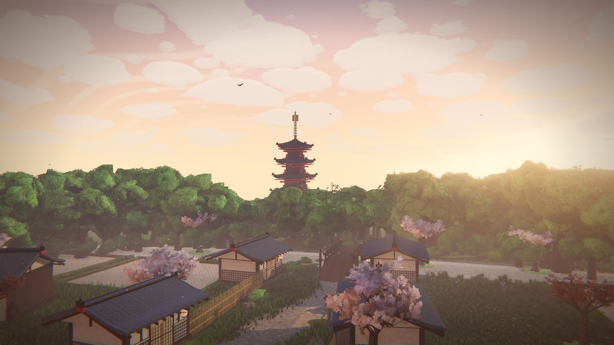</a>
</p>
<p align="center"><sub>A real frame from the game: the valley at golden hour (captured 2026-11-16 on the modular asset set). <a href="#from-the-build">More captures</a></sub></p>

### A Third-Person Cat Exploration Game set in a Kyoto-Inspired Valley

**🐾 Ready to explore Kyoto? Play now — free, instant, no install:**

[](https://c1t1zen1.github.io/Michi-Neko-The-Cat-Philosophers-Path/)

*Free · No download · No install · Just click and stroll.*

> **Status:** Very Early Alpha · Built with vibe coding and several SOTA AI models  
> **Inspiration:** Studio Ghibli films and a honeymoon trip to Kyoto, Japan  
> **Engine:** Three.js (r160) · WebGL 2.0 · Pure browser — no dependencies to install  
> **License:** MIT\
> **Last updated:** 2026-11-16 · cache tag `20261116a` · see [Roadmap](#roadmap)

**Contents:** [What it is](#what-it-is) · [Three places](#three-places-to-wander) · [From the build](#from-the-build) · [What is new](#what-is-new-the-modular-asset-system) · [Play](#play) · [Quality](#quality-and-compatibility) · [Setup](#project-setup) · [Architecture](#architecture) · [Make and swap an asset](#make-and-swap-an-asset) · [Companion tools](#companion-tools) · [Verification](#verification) · [Roadmap](#roadmap) · [How this was made](#how-this-was-made) · [License](#license) · [Credits](#credits)

---

## What it is

**Michi-Neko** is a meditative third-person exploration game: you are Michi, a small tabby cat, wandering a stylised Kyoto valley, a secret hilltop above the city, and the roofs of the old town. There are no enemies, no timers and no fail states — you explore, make friends with the village cats, find hidden places, and sit still to watch the light change. It runs in any WebGL 2 browser with nothing to install, and it is very early alpha: the core loop works, the world is beautiful, and much remains to be built.

### Inspirations

- **Studio Ghibli** — the warm, hand-painted aesthetic of films like *The Cat Returns* and *Spirited Away*
- **Kyoto, Japan** — a real honeymoon trip that sparked the vision: machiya streets, torii gates, temple bells, koi ponds, bamboo forests
- **Journey, Outer Wilds, A Short Hike** — exploration-first games that reward curiosity over combat

---

## Three places to wander

### The Kyoto village (the valley)

<p align="center">
  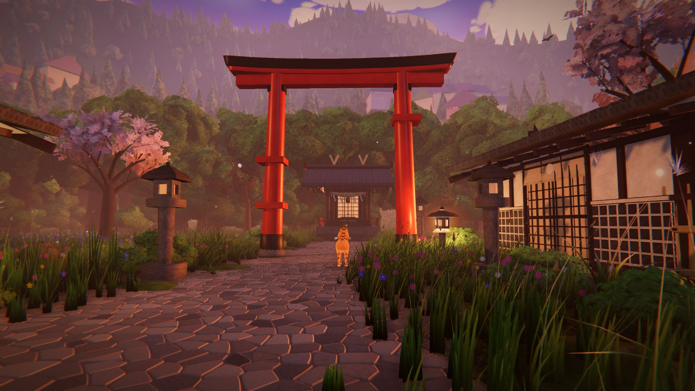
</p>
<p align="center"><sub>Michi at the torii as the lanterns kindle (captured 2026-11-16, modular set).</sub></p>

Where every game starts: a hand-crafted countryside of machiya townhouses, a vermilion torii shrine, a river with koi, paddies, bamboo groves and a hidden tea house. What you can do:

- **Meet the villagers** — Luna, Mochi and Kuro, each with a coat, a build, habits, a greeting and a daily routine
- **Follow the quests** — Luna's Yarn Hunt, Luna's Leap to the turtle corral and the Jade Paw, Kuro's Offering Bells, the spirit altar that only appears in mist, the golden feather on the rooftop nest ([every task](NPC_TASKS_AND_ENDGAME_GUIDE.md))
- **Find the secret tea house** — the antique key near the bamboo shrine opens a machiya door onto a full Japanese interior
- **Find the hidden places** — the Moon Pool and the Lantern Glade, with no markers pointing to them
- **Sit and watch** at rest spots until a *stillness moment* arrives, and keep it all in the discovery journal
- **Be a cat** — meow, prowl, groom, slow-blink, bat the furin chime, tip the shishi-odoshi, paw at the koi, climb the roofs, take photos

<details>
<summary><b>Everything in the valley</b> (world, the cat, gameplay, audio, interface)</summary>

#### World & atmosphere
- **Procedural Kyoto valley** — machiya townhouses, torii shrine gate, stone paths, river with water physics, bamboo groves, cherry trees, and surrounding mountains
- **Dynamic day/night cycle** — a full 24-hour loop compressed to 60 minutes, with sunrise, golden hour, sunset, and night each bringing unique lighting moods
- **Living weather system** — clear, cloudy, rain, snow, and mist states that transition smoothly and affect fog, lighting, and audio
- **Procedural PBR materials** — every surface is painted at load time: lime plaster with sill grime, grained timber, staggered kawara roof tiles, glowing shoji lattice, woven tatami, river-stone cobbles and fissured bark, each with a matching normal map, so walls and roofs catch light with real relief
- **Curved Kyoto rooflines** — roof slopes carry the concave *sori* lift toward the eaves, with rows of round end-tiles and rafter tails under every eave
- **Painterly foliage shader** — one shared shader for sakura, maples, pines, street bushes and the forest wall: lumpy noise-displaced canopies with leaf-clump relief, top-lit crowns, cool violet undersides, sun translucency and wind sway; bushes rustle when the cat brushes through
- **Grass from the Grass Lab** — the valley grows every Lab recipe, each where it suits: Bezier tufts that keep the cat's trail near the camera, tri-quad clumps and painted cards further out, a shell carpet under the paws, cat-eye thicket along paths and walls, wildflower drifts, susuki on the river banks and the wild rim, mown lawns in the shrine precinct, moss pillows at tree roots and the Moon Pool, lantern fibres that glow at night in the Lantern Glade, yarn curls in the turtle corral, and fireflies over the river after dark. A biome mask painted from the real buildings, paths and water decides what grows where; blades take shadows, lantern light and fog, and part around the cat and the villagers
- **Ridged mountain walls** — a noise-driven height field carries the valley floor into wooded foothills and blue-hazed peaks instead of cone silhouettes
- **Living river** — a fresnel water shader with sun-tracking specular, drifting sparkle, lapping bank foam and molten dusk tones
- **Cinematic post stack** — depth-based ambient occlusion, exponential height fog with sun in-scatter, screen-space crepuscular light shafts, bloom, ACES tone mapping and a filmic grade (split-toning, vignette, grain)
- **Image-based lighting** — the sky dome is re-baked into a prefiltered environment map as the day cycles, so tiles, lacquer, water and bronze reflect the real sky and sun
- **Night lanterns that light the street** — a pool of point lights hops between the lanterns nearest the cat, flickering warm pools onto the cobbles after dusk; each lantern kindles at its own moment as the light fails, and village windows glow behind them
- **Dawn river mist** — low, drifting mist hugs the water around 06:15 and burns off by mid-morning (thicker in misty weather)
- **Rain on water** — a dedicated pool of raindrop rings dimples the river and ponds during rain, separate from the cat's and koi's ripples
- **Edo skirt walls** — village machiya wear *namako-kabe* (dark slate tiles in raised white joints), eave beams and wall studs; the torii has brushed-lacquer grain, a swept *kasagi* and black base collars
- **Hidden valley places** — the **Moon Pool** (a still spring west of the shrine grove: turquoise caustics by day, moon-glow and rising motes by night, glassy pentatonic drops) and the **Lantern Glade** (a bamboo ring with paper lanterns that kindle in turn, fireflies, hollow bamboo knocks and breaths of leaves). No markers point to them — wander, or follow the scent trail when you get close

#### The cat
- **Sculpted, skinned cat** — one seamless coat sculpted from soft anatomical forms (deep ribcage tucking into the waist, sliding shoulder blades, haunches) and skinned to a feline skeleton: forelegs with a backward elbow, hind legs in the thigh → stifle → hock zig-zag, rounded paws, a six-bone tail about half the body's length, and a round head with cheek fluff and a short muzzle. Luna, Mochi and Kuro each get their own build (slender, round, long-limbed)
- **Painted Ghibli face** — big amber eyes with heavy ink lids, catchlights, mood-sized pupils, real blinks (and slow "I trust you" blinks), the "ω" mouth that opens to meow and yawn, a pink (or dusky, on black cats) nose, white whiskers, tufted ears; NPCs turn their heads to follow you
- **Procedural tabby coat** — exactly four bold mackerel stripes across the back, forehead "M", cheek lines, leg bars, tail rings with a dark tip, cream bib, belly and socks, painted in bind-pose space so it rides the animation; three-band toon ramp, painterly grain, a true silhouette rim light keyed to the sun, and a cool sheen that keeps black cats black
- **Braided silk collar** — a kumihimo cord with gold edge threads and a little bow, carrying an engraved suzu bell (equator band, sound slit, sakura crest); Master Cat rank turns it gold and adds a twin
- **Cat animations** — paws are placed by leg IK, so they plant without sliding: a lateral-sequence walk that eases into a trot and, when sprinting, a rotary gallop with spine flexion; jump, land, prowl crouch (shoulder blades up, tail low), turn-in-place steps, and the head held level through it all. Idle verbs are real cat poses: sit with the tail wrapped round, lick-a-paw grooming, play-bow stretch, yawn, crouch-to-drink, and a curled-up sleep. Plus ear flicks, tail sway, a bottlebrush tail when startled, and mood expressions (curious, playful, cautious, alert, sleepy)
- **Villager personalities** — Luna (silver smoke-grey, slender) grooms and sits, and greets with a slow blink; Mochi (ginger, round) stretches, yawns and bounds up playfully, and curls up to sleep at night; Kuro (solid black, long-limbed) sits and watches, wary at first, warming as you linger. Each reacts to being noticed, greeted, or startled by a sprinting cat
- **Prowl mode** — crouch low and move quietly at reduced speed (press C)
- **Scent trail** — warm particle wisps drift up behind the cat as it moves, fading from gold to amber

#### Gameplay
- **Yarn ball collectibles** — scattered throughout the valley, each gives XP and triggers a satisfying chime
- **Quest system** — Luna's Yarn Hunt introduces the world and rewards exploration
- **Progression ranks** — Kitten → Curious Cat → Backyard Explorer → Rooftop Wanderer → City Legend. Walking, sprinting, jumping and prowling are yours from the first step; the ranks add a higher jump, more speed, and at City Legend a golden bell for the collar (Master Cat)
- **Three NPC cats** — Luna (mysterious moonlight cat), Mochi (cheerful bamboo grove cat), and Kuro (quiet river guardian) — each with their own coat, build, dialogue and daily routine: Luna keeps watch from the old bridge at night, Kuro visits the river in mist and shelters under the tea-house eave in rain, Mochi chases bamboo leaves in the wind and sleeps at night
- **Quests and secrets** — Luna's Yarn Hunt (and Luna's Leap, which leads to the turtle corral and the Jade Paw), Kuro's Offering Bell quest, the spirit altar that only appears in mist, the golden feather on the rooftop nest — see [NPC_TASKS_AND_ENDGAME_GUIDE.md](NPC_TASKS_AND_ENDGAME_GUIDE.md)
- **Rest & watch spots** — sit and watch at the shrine steps, old bridge, rooftop perch, bamboo clearing, tea-house porch, the two hidden places (and the torii crown, once you are a City Legend). Stay still for about eight seconds and a *stillness moment* arrives, written for the time of day and the weather
- **Discovery journal (press J)** — a keepsake memory of the valley, not a checklist: places found, quiet moments, photographs stamped at rest spots, weather memories, keepsakes
- **Cat verbs and micro-interactions** — sit / groom / stretch, slow-blink at an NPC, gift a yarn ball, bat the furin chime, tip the shishi-odoshi, scratch the bamboo and fence post
- **Secret tea house** — find the antique key hidden near the bamboo shrine, unlock the machiya door, and step inside a fully modeled Japanese interior with tatami mats, tokonoma alcove, hanging scroll, bonsai, and a zen rock garden
- **Interior interactions** — eat grilled sea bream for a speed boost, curl up on a zabuton cushion for a cozy nap that advances time by 4 hours
- **Rooftop bird's nest** — climb to the highest point to discover a nest with a guardian's feather trophy
- **Shrine bell** — ring the sacred bronze bell at the torii gate for blessings (and, rung ten times, the way to the hilltop)
- **Koi pond** — wade into the river to paw at swimming koi fish or drink fresh water
- **Photo mode** — press P to enter a free-camera photo mode, orbit/zoom, and capture PNG screenshots

#### Audio
- **Generative day-phase music** — a real-time music director that layers a warm pad drone with sparse koto-style plucks, shifting key and mood across dawn, day, dusk, and night
- **Procedural sound effects** — footsteps (grass/water), meow, jump, land, collect chime, bell, splash, purr, door slide, key chime, dream chime, eat, lap water, trill — all synthesized via Web Audio API, no audio files needed
- **Adaptive ambient** — weather-aware ambient layers that crossfade between clear, rain, and mist soundscapes
- **Place-specific sound** — the Moon Pool's glassy drops and the Lantern Glade's bamboo knocks and leaf breaths are synthesised live and fade with distance; the Tea House, the summit and the Roof Road each get their own music mood
- **Kit sounds** — on the modular asset set, kit assets voice their own moments (the shishi-odoshi's clack, the wind chime, lanterns kindling, the shrine bell, the nest), from a dawCAT sound pack loaded on the first event (`src/kit/sfx_pack.js`); the classic set never loads it
- **Replaceable by design** — [dawCAT](#dawcat-20--audio-asset-studio-dawcat) can scan the game's music and sound effects and export drop-in replacements (`music.js`, `sfx-pack.js`) without touching game code

#### Interface
- **Japanese parchment scroll HUD** — an emakimono-style collapsible scroll showing yarn count, rank, XP bar, active quest, time/weather, and inventory badges
- **Compass strip** — top-center compass with cardinal directions and POI icons for NPCs, the tea house, and collectibles
- **Objective markers** — screen-space waypoint icons with distance labels and an off-screen edge arrow
- **Title screen** — animated paw logo, cinematic orbit camera, and New Game / Continue / Settings menu
- **Settings panel** — master/music/SFX/ambient volume sliders, camera sensitivity, invert Y, graphics quality (auto/low/medium/high), hint toggle, interface mode (*Minimal* keeps only the context prompt; *Guided* adds the parchment and markers), and save export/import — all persisted to localStorage
- **Soft guidance** — waypoint arrows only guide when hints are on; the scent trail only flows near things worth finding
- **Touch controls** — virtual joystick, JUMP, ACT, and MEOW buttons for mobile play
- **Debug overlay** — press F3 for FPS, draw calls, triangle count, and GPU memory info

</details>

### The meditation hilltop (天上)

<p align="center">
  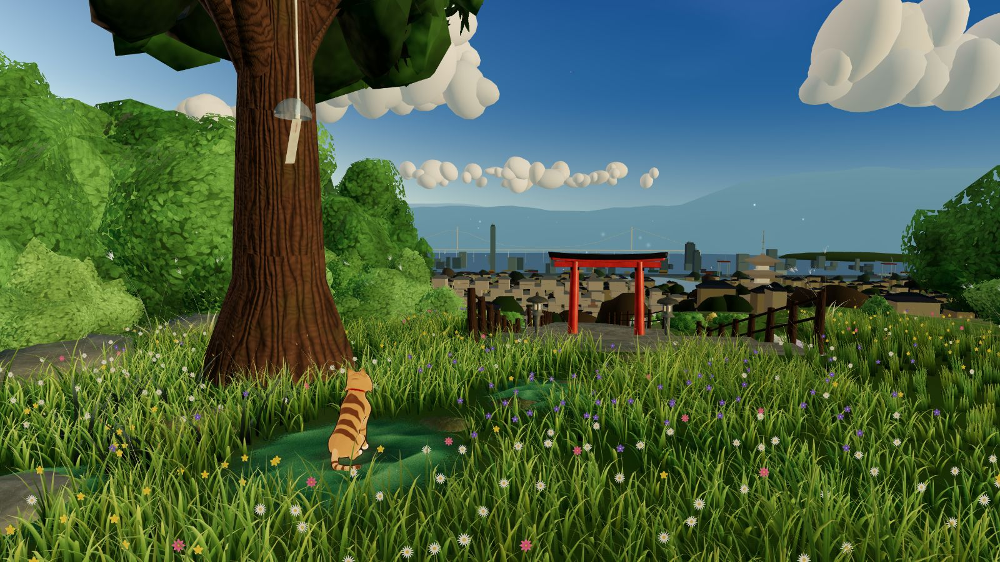
</p>
<p align="center"><sub>The meditation seat above the Kyoto basin, morning (captured 2026-11-16 with the summit review page, modular set).</sub></p>

A last secret waits above the shrine. **Ring the shrine bell ten times**: the thicket behind the shrine parts and light spills through. Step into it and you arrive in a wind-combed meadow high above Kyoto, with the city, Osaka and the bay descending through layered distance.

- **No quests, no hints, no NPCs.** Sit still and the cat sleeps; the mountain keeps watch
- **Its own sound** — a sound-bath music mood with monk-choir and singing-bowl audio, and an optional transition video (`assets/`; every slot has a fallback)
- **Sumi-e brush grass** by the ensō stone, wind-combed meadow grass, summit weather, pollen, petals, butterflies and birds
- **Walk back under the gate** to return to the valley

The summit had its own polish pass in November 2026 (lane `a2-hilltop`). Its meditation view was accepted provisionally, and the operator may still change it.

### The Roof Road (屋根道)

<p align="center">
  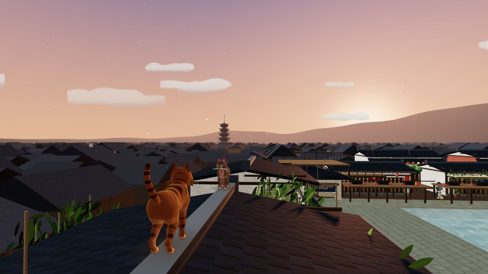
</p>
<p align="center"><sub>Michi and Chidori on a ridge at dusk, the pagoda on the skyline (captured 2026-11-16 on the Roof Road sandbox page, modular set).</sub></p>

Level two, past the valley bridge: a side-scrolling run over the roofs of an imagined downtown Kyoto. **To open it,** walk the bridge's east railing from the north end to the south end without stepping off. Each of the seven posts warms and sings the next note of a rising scale; step off and the glows fade back (a quiet reset, no penalty, no time limit). At the seventh note the bamboo on the old earthen wall (the Odoi bank) south of the bridge parts, and a noren hangs in the gap. Walk through it.

- **Follow Chidori**, the guide cat, about 1.7 km along the roofs through eleven named districts, from Awataguchi and Pontochō past the Takase canal, the Nishiki canopy and the laundry decks to the Gion Matsuri float streets and Shirakawa
- **Choose your height** — roofs, trellises, laundry lines and pole crossarms above; alleys, market rafters and canal stones below. The streets are safe: a missed jump lands in the street, and every metre of street has a way back up within 12 m
- **Greet the seven clay Shōki** roof guardians; each one goes in your journal
- **The sky follows you**, not the clock: afternoon into night as you travel, standing still stops time
- **The finale** — the top of a festival float with the five Okuribi fires kindling on the hills. A paper lantern drifts past; follow it and it takes you home. "Leave the Roof Road" in the pause menu takes you home at any time
- **Saved** — the unlock, the Shōki you greeted and the finale. A save made on the roofs reloads on the bridge's south ramp

The Roof Road is in the game on both asset sets. It also runs on a page of its own, which the game does not link to:

[](https://c1t1zen1.github.io/Michi-Neko-The-Cat-Philosophers-Path/kyoto-rooftops.html)

*Opens on GitHub Pages · [controls, flags and checks](rooftops/README.md) · [design](docs/superpowers/specs/2026-10-24-rooftop-road-design.md) · [inner-Kyoto research](docs/ROOFTOPS_RESEARCH_2026-10-24.md) · [downtown notes](docs/ROOFTOPS_DOWNTOWN_2026-11-13.md) · [source in `rooftops/`](rooftops/)*

---

## From the build

Real frames from the game, captured on 2026-11-16 by [`tools/hero_capture.mjs`](tools/hero_capture.mjs) from the game code of commit `9c7f490`. They use the **modular** asset set (`?assets=modular`), which is not the default yet ([what that means](#what-is-new-the-modular-asset-system)). Nothing is painted over or composited. The shot list is [`docs/images/hero/shots.json`](docs/images/hero/shots.json); [`docs/images/README.md`](docs/images/README.md) gives the command and commit for every file.

<p align="center">
  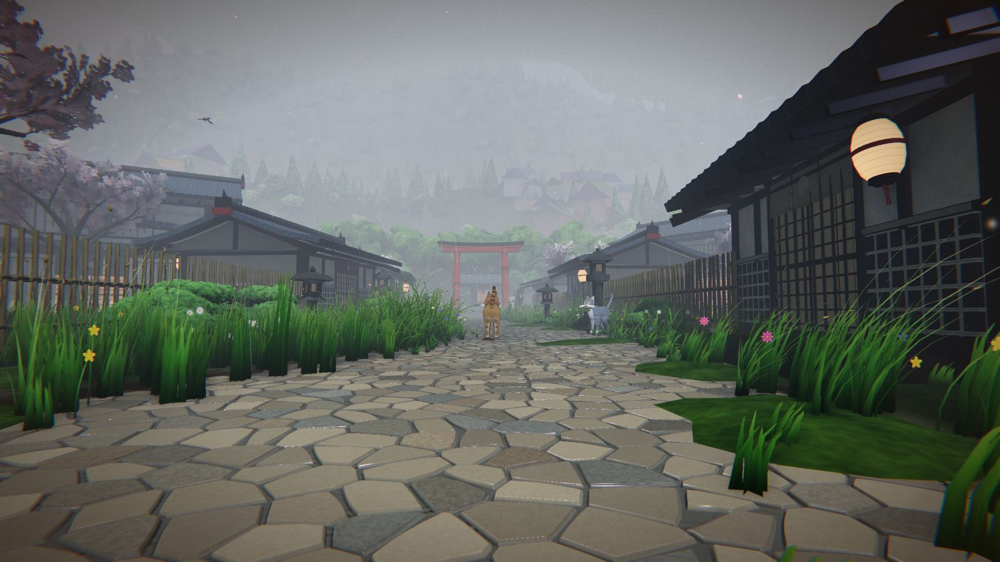
  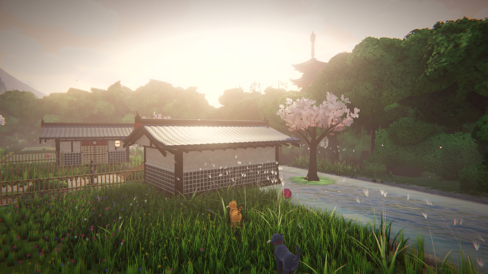
</p>
<p align="center"><sub>The machiya lane in the rain, at cat height · The river in the morning, Michi and Kuro</sub></p>

<p align="center">
  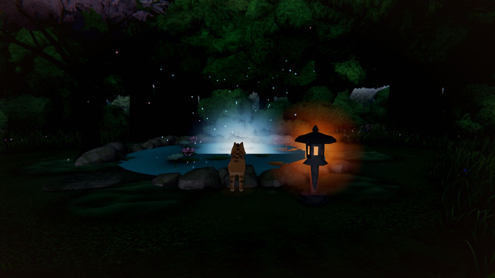
  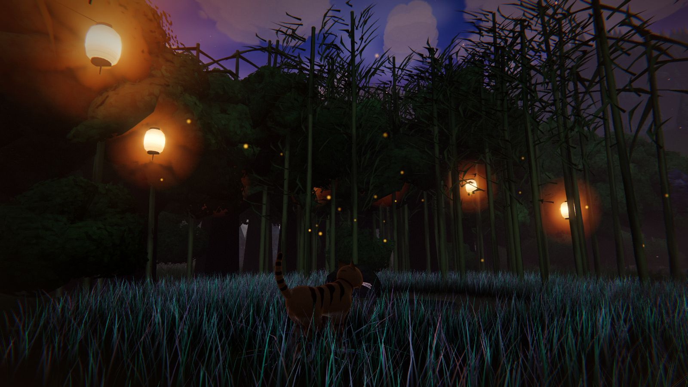
</p>
<p align="center"><sub>The Moon Pool at night · The Lantern Glade, lanterns lit</sub></p>

<p align="center">
  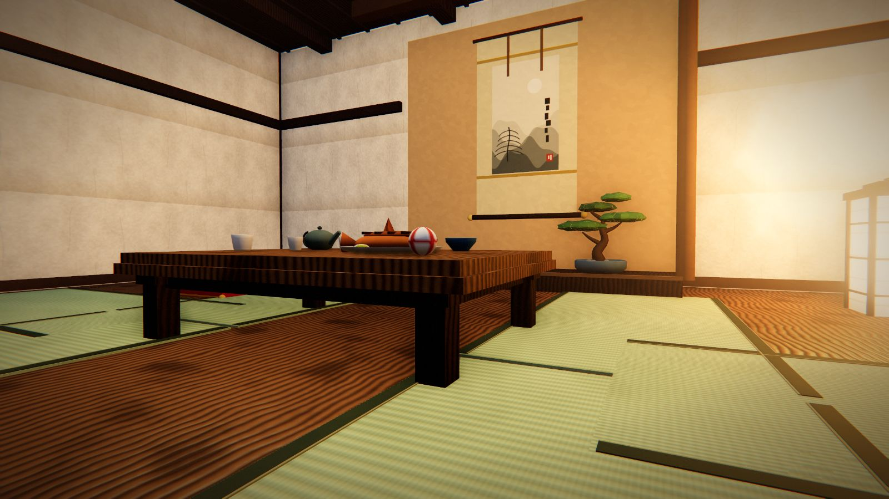
  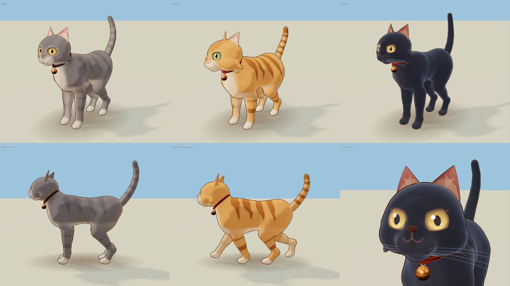
</p>
<p align="center"><sub>The tea house, low sun through the shoji · Luna, Mochi and Kuro (the <code>npcs</code> review sheet: the real <code>Cat</code> without the game's post-processing)</sub></p>

<p align="center">
  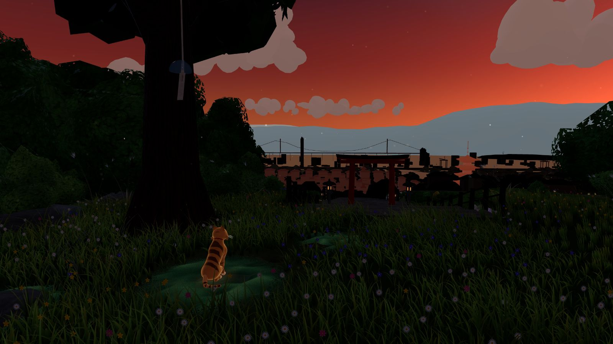
  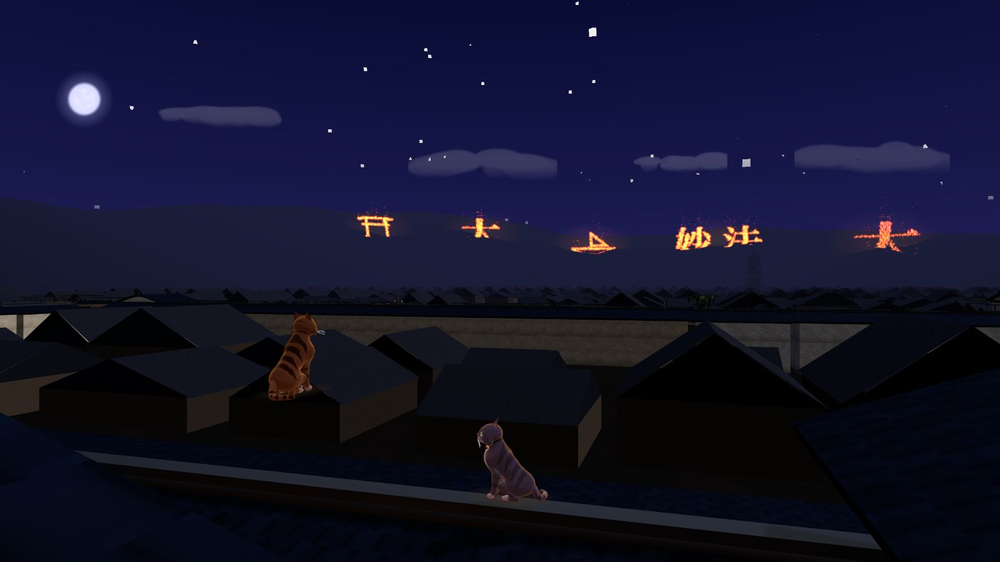
</p>
<p align="center"><sub>The summit vista at dusk · The Roof Road finale, the five Okuribi fires (sandbox page)</sub></p>

---

## What is new: the modular asset system

Until November 2026 every object in the game came from one large builder function per area. Those builders are still here, untouched — we call them **classic**. Beside them now sits a second way to build the same world, the **kit** (`src/kit/`): **187 assets in 28 families** (lanterns, fences, rocks, the shrine, machiya, the pagoda, ground, water, sky, trees, critters, the summit clearing and vista, the Roof Road's streets, canal, festival and cast, and more). Each kit asset was promoted from a study in the [Labs](#the-labs-labs) and records which one.

Every kit asset follows the same rules:

- It is **split into named parts** (`asset:toro/kasa`, `asset:toro/sao`, …), so tools can find and edit one piece
- It has **three levels of detail** (`hero`, `mid`, `far`), chosen once at build time from the quality tier and the distance
- It is **seeded**: the same layout gives the same geometry, every time
- It **keeps the gameplay footprint** of the classic object: the same colliders, climb surfaces, anchors and names (or a recorded waiver)
- It stays **inside budgets** for triangles, draw calls and build time, checked by a contract test
- Its **parameters are editable** in the Asset Library and cadJS, and the AI assistants can set them through a validated action
- If a kit builder ever fails, the game logs it once and **builds the classic object instead**

The characters went the same way (`src/characters/`): Michi, Luna, Mochi, Kuro, Larry the turtle, the guardian crows and the Roof Road's Chidori are character definitions with accessory slots (collar, bell, head, back) and their own detail tiers.

<p align="center">
  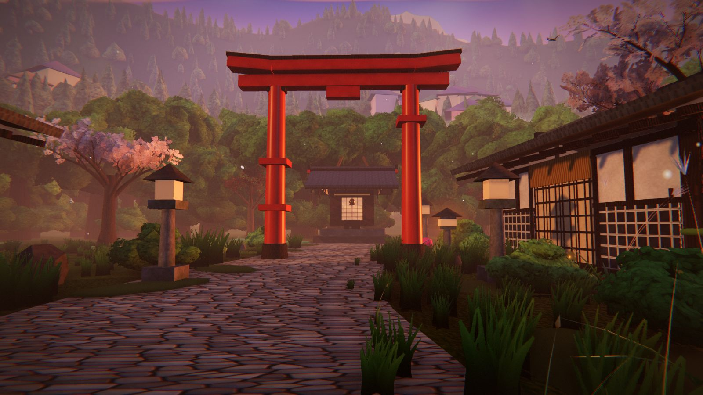
  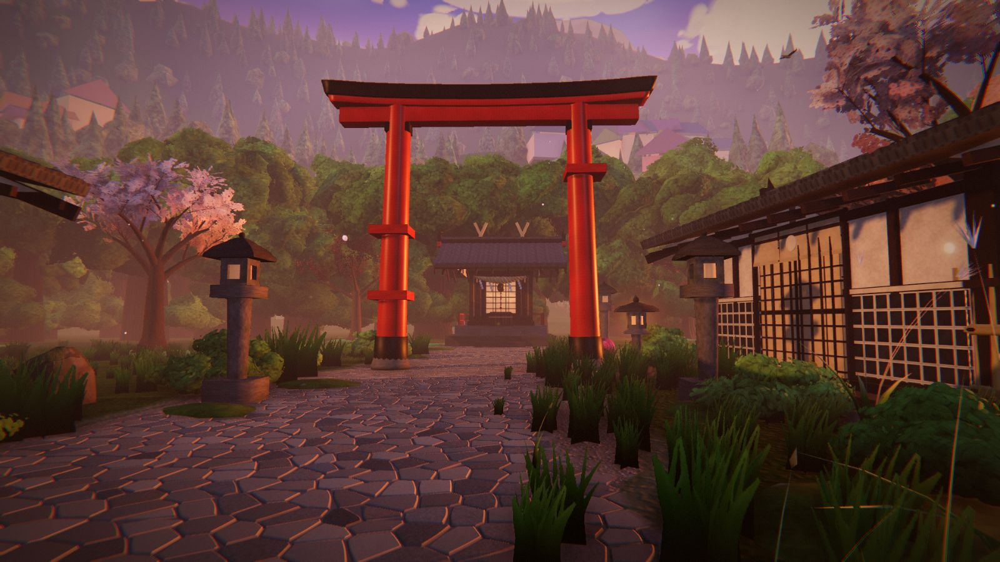
</p>
<p align="center"><sub>Before and after, one camera at 18.5 h: the classic set · the modular kit (two separate real frames, 2026-11-16)</sub></p>

<p align="center">
  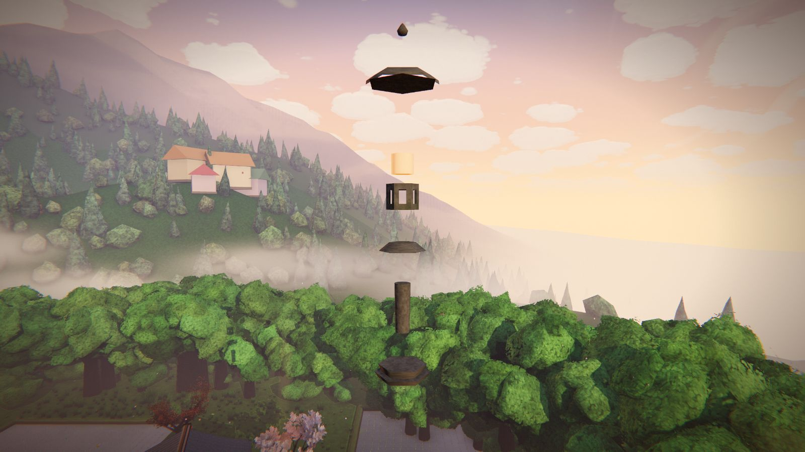
</p>
<p align="center"><sub>A parts sheet: a kit stone lantern built in the running game, its eight named parts (<code>kiso</code>, <code>sao</code>, <code>chudai</code>, <code>hibukuro</code>, <code>lamp</code>, <code>halo</code>, <code>kasa</code>, <code>hoju</code>) lifted apart by script (2026-11-16)</sub></p>

**Classic is still the default.** Players on the live site get the classic set unless they ask for the kit. You can try modular now:

- **`?assets=modular`** on the game's address, for one session: [play on the modular set](https://c1t1zen1.github.io/Michi-Neko-The-Cat-Philosophers-Path/?assets=modular)
- **`?swap=toro:modular`** to swap one asset (or a list, `?swap=toro:modular,torii:classic`; a bare id means modular)
- The **`assetSet` setting** exists (`'classic'`, `'modular'` or `'auto'`) but has no menu entry yet. From the browser console: `game.settings.set('assetSet', 'modular')`, then reload. On quality Low it is ignored and the game stays classic

Making modular (or `auto`) the default is a later step. It needs a final review of the whole build and the operator's approval, and one budget is still open: on the modular set the world takes 1.26–1.42 times as long to build as classic, against a rule of 1.25 ([budgets](docs/fable/baseline/budgets.md), section 2). A few pieces have no kit version yet and build classic on both sets, among them the Roof Road's bridge, corner house, alleys and street, and the valley's Seven Posts and Odoi bank ([the list](BUILD_GUIDE_FABLE.md#0-status-and-how-to-resume-paused-2026-11-16)).

---

## Play

<p align="center">
  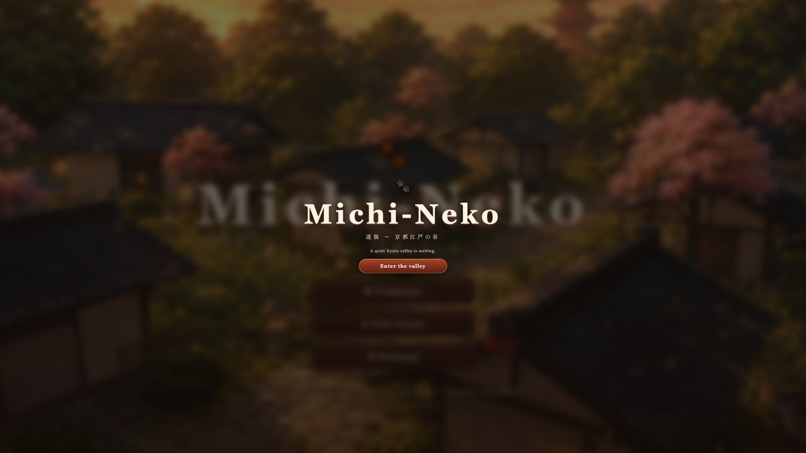
</p>
<p align="center"><sub>The live title menu (captured 2026-11-16). Its backdrop, <code>title-screen.jpg</code>, is concept art.</sub></p>

### Desktop

| Key | Action |
|-----|--------|
| `W` `A` `S` `D` / Arrows | Move |
| `Shift` | Sprint |
| `Space` | Jump (hold for higher, tap for short hop) |
| `E` | Context action (talk, pick up, interact, enter/exit, sit and watch) |
| `M` | Meow |
| `C` | Toggle prowl mode |
| `P` | Photo mode (orbit camera, capture screenshots; not on the Roof Road) |
| `J` | Discovery journal |
| `Esc` | Pause menu |
| `F3` | Debug overlay |
| Mouse drag | Rotate camera (yaw + pitch) |

### Mobile / Touch

| Touch | Action |
|-------|--------|
| Left joystick | Move (push to edge to sprint) |
| JUMP button | Jump |
| ACT button | Context action |
| MEOW button | Meow |
| Swipe right side | Rotate camera |

### On the Roof Road

| Desktop | Touch | Action |
|---------|-------|--------|
| `←` `→` or `A` `D` | Stick left / right | Run |
| `Space`, `W` or `↑` | JUMP | Jump (hold for height) |
| `↓` or `S` | Stick down | Drop to a lower route |
| `Shift` | Stick to the edge | Sprint |
| `R` | — | Back to the last lantern |
| `Esc` | — | Pause; *Leave the Roof Road* takes you home |

A short hint with these controls and the way home shows on each arrival, until you have reached the finale once.

### Comfort settings

Open **Settings** from the title screen or the pause menu. Everything applies live and is remembered.

- **Field of view** 40–90° and **interface size** 80–150%
- **Larger dialogue text** and **high-contrast prompts** and dialogue
- **Reduce motion** — *Follow system* (the default), *On* or *Off*. On stills FOV kicks, camera auto-follow swing, the title orbit, rest-camera drift, film grain, lens fringe and CSS animation. It reaches the Roof Road live too (camera easing, cloud drift, festival motion); the float's tassels and musicians keep the sway they were built with until your next visit to the roofs
- **Film grain** and **lens fringe** toggles (fringe is a High-quality effect)
- **Interface mode** — *Minimal* (just the context prompt) or *Guided* (the parchment scroll and markers); **Show hints**
- Volumes, camera sensitivity, invert look Y, graphics quality, and save export / import

The full gameplay manual is [QUICKSTART.md](QUICKSTART.md).

---

## Quality and compatibility

### Quality tiers

Graphics quality is *Auto*, *Low*, *Medium* or *High* (Settings). What each tier does today (`Game.applyQuality()` in `src/main.js`):

| | Low | Medium | High |
|---|---|---|---|
| Pixel ratio cap | 1.0 | 1.25 | 1.75 |
| Sun shadow map | 1024 | 2048 | 4096 \* |
| Shadow refresh | every 2nd frame | every 2nd frame | every frame |
| MSAA | off | off | 4× |
| Ambient occlusion | off | 8 samples | 14 samples |
| Bloom | off | on | on |
| Light shafts | off | on (off on phones) | on |
| Grass and particles | 50 % | 75 % | 100 % |
| Lantern point lights | 2 | 4 | 4 |
| Asset set | always classic | your setting | your setting |

\* On a desktop with a discrete GPU; 2048 everywhere else.

- **Auto** picks a tier from the device. Phones get Medium with 6 or more CPU cores and Low otherwise. Desktops get High only with 8 or more cores, a pixel ratio of 2.5 or less and a GPU the game recognises as discrete; otherwise Medium. A one-time probe on the title screen can lower the starting tier on a weak device; it never raises it
- **Adaptive resolution** — a two-stage governor: when the frame rate stays under 45 fps, stage 1 sheds light shafts and quarters the bloom, stage 2 scales the framebuffer; above 58 fps it walks back up, with hysteresis. An eco frame floor (30 fps) protects long sessions from heat, and touch devices run the title screen at half rate

### The asset set

- **`assetSet` setting** — `'classic'` (default), `'modular'` or `'auto'` (classic on Low, modular otherwise). No menu entry yet
- **`?assets=`** — `classic`, `modular` or `auto` for one session, over the setting. A developer flag: it can force the kit even on Low
- **`?swap=`** — Per asset, for A/B checks: `?swap=toro:modular,torii:classic`. It wins over everything else for the ids it names
- **`kit-overrides.json`** — Published parameters and per-asset variants (written by the Asset Library and cadJS). Read only when the kit can be active. Today it pins `edge-forest` to classic

**Low-power devices are unaffected by the kit.** On quality Low, without an explicit `?assets=`, the game always builds classic and never downloads the kit's families, materials or `kit-overrides.json`. The classic set makes no extra request at all.

**Saves** do not change with the asset set. A save made on either set loads on the other, and saves made before the Roof Road load too (the Roof Road's flags are additive).

### What has and has not been benchmarked

- **Measured, on the dev machine only:** an Apple M5 Max, headless Chromium on Metal, 1200×750. Four fixed valley spots on all three tiers, both sets, day and night: frame time, draw calls and triangles against [the budgets](docs/fable/baseline/budgets.md) ([perf_gv3.md](docs/fable/baseline/perf_gv3.md)). Every kit asset is checked against per-tier triangle, draw-call and build-time budgets by the contract test
- **Not measured:** real phones and tablets, integrated and low-end GPUs, browsers other than Chromium, battery and heat. The budgets are not phone budgets; Low is protected by construction instead (above). The summit and Roof Road performance spots are part of the final review, which has not run yet
- **Known gap:** the modular world build (1.26–1.42 × classic against 1.25 ×), which blocks the default flip only

---

## Project setup

**Play in the browser:** [c1t1zen1.github.io/Michi-Neko-The-Cat-Philosophers-Path](https://c1t1zen1.github.io/Michi-Neko-The-Cat-Philosophers-Path/) — the live site runs the `main` branch.

**Requirements:** a WebGL 2 browser (current Chrome, Edge, Firefox or Safari) and network access, because Three.js r160 loads from the unpkg CDN through the import map in `index.html`. No build step, no package install.

**Run it locally** from the repository root (ES modules need http, not `file://`):

```bash
python3 -m http.server 8000   # Windows: py -m http.server 8000
# or with Node.js
npx serve -l 8000
```

Then open **http://localhost:8000**. Other pages on the same server:

| Page | What it is |
|---|---|
| `/` | The game (`/?assets=modular` for the kit) |
| `/kyoto-rooftops.html` | The Roof Road sandbox page |
| `/labs/` · `/labs/grass/` | The Labs hub · the Grass Lab |
| `/catalog/` | The Asset Library (browsing; saving needs the one server below) |
| `/dawCAT/` | dawCAT, the audio studio |
| `/Shinkansen/` | *Eastbound*, a standalone stage-03 prototype |

**The one-server option.** `node cadJS/server.mjs` (Node.js 22 or newer, no `npm install`) serves everything on one origin and adds the write and AI routes:

```bash
node cadJS/server.mjs
# game:    http://127.0.0.1:4173/
# assets:  http://127.0.0.1:4173/catalog/
# cadJS:   http://127.0.0.1:4173/cadJS/
```

`PORT` and `HOST` change the address; keep it on `127.0.0.1` unless you mean to expose it. Use one origin for the game, the catalog and cadJS: browser storage and settings belong to an origin.

More setup help, phones on your network and troubleshooting: [INSTALL.md](INSTALL.md).

### Documentation

- [INSTALL.md](INSTALL.md) — Running the game locally, browser/device setup, troubleshooting
- [QUICKSTART.md](QUICKSTART.md) — Extended gameplay manual: controls, progression, the hilltop, the Roof Road, secrets
- [NPC_TASKS_AND_ENDGAME_GUIDE.md](NPC_TASKS_AND_ENDGAME_GUIDE.md) — Every NPC task, dialogue riddle and end-game reward
- [FUTURE_QUESTS.md](FUTURE_QUESTS.md) — Planned quests, world expansion and story direction
- [AGENTS.md](AGENTS.md) — Contributor / agent notes: layout, run, cache-busting, verification, guardrails, status
- [BUILD_GUIDE_FABLE.md](BUILD_GUIDE_FABLE.md) — The modular asset build: architecture, the asset contract, the board, the resume point (§0)
- [docs/fable/](docs/fable/README.md) — That build's decisions, baselines and budgets, lane status and handoffs, and the swarm's records
- [docs/images/README.md](docs/images/README.md) — Every README image: capture or concept art, shot id, date, commit, command
- [catalog/README.md](catalog/README.md) — Asset Library: inventory, production variant, swap board, cadJS imports, AI setup
- [labs/ASSET_COVERAGE.md](labs/ASSET_COVERAGE.md) — Asset-by-asset evidence and lab coverage audit
- [rooftops/README.md](rooftops/README.md) — Roof Road sandbox: controls, review flags and checks
- [docs/superpowers/specs/2026-10-24-rooftop-road-design.md](docs/superpowers/specs/2026-10-24-rooftop-road-design.md) — Roof Road design: the unlock, the mouths, mechanics, how it goes into the game
- [docs/ROOFTOPS_RESEARCH_2026-10-24.md](docs/ROOFTOPS_RESEARCH_2026-10-24.md) — Roof Road research: inner Kyoto's walls, gates, machiya roofs, districts and festivals, cat jump numbers, 2.5D path design, sources
- [docs/ROOFTOPS_DOWNTOWN_2026-11-13.md](docs/ROOFTOPS_DOWNTOWN_2026-11-13.md) · [docs/ROOFTOPS_AGILITY_2026-11-13.md](docs/ROOFTOPS_AGILITY_2026-11-13.md) — Roof Road stage 2: downtown overview, agility and scenery research
- [docs/VISUAL_NEXT_STEPS_2026-10-24.md](docs/VISUAL_NEXT_STEPS_2026-10-24.md) — Ranked list of what to research and rebuild next, after the grass
- [labs/grass/research.md](labs/grass/research.md) — Grass Lab research: what 15 searches found, the numbers, the design decisions, sources
- [labs/REVIEW_2026-11-10.md](labs/REVIEW_2026-11-10.md) — Construction review of the lab specimens
- [docs/DEEP_ANALYSIS_REVIEW_2026-11-08.md](docs/DEEP_ANALYSIS_REVIEW_2026-11-08.md) — Deep analysis review of the game and tools
- [docs/NEXT_STEPS_CHECKLIST_2026-10-22.md](docs/NEXT_STEPS_CHECKLIST_2026-10-22.md) — The 2026-10-23 upgrade checklist, with what shipped and what is still open
- [docs/NEXT_STEPS_FEEDBACK_2026-10-22_195413.md](docs/NEXT_STEPS_FEEDBACK_2026-10-22_195413.md) — The feedback that drove that checklist
- [docs/BUILD_GUIDE_2026-09-11_041436.md](docs/BUILD_GUIDE_2026-09-11_041436.md) — Parallel-agent build checklist (workstreams A/S/P/AU/C/N/G/U/V) with live status
- [docs/GAME_MASTER_REVIEW_2026-09-11.md](docs/GAME_MASTER_REVIEW_2026-09-11.md) — Merged master review the build guide came from
- [docs/VERIFICATION_REPORT_2026-09-11.md](docs/VERIFICATION_REPORT_2026-09-11.md) — Measured results of the 44-check browser suites
- [docs/PERFORMANCE_REVIEW_2026-09-10_022247.md](docs/PERFORMANCE_REVIEW_2026-09-10_022247.md) — Mobile-first performance audit & optimisation plan
- [docs/SBA_REVIEW_20260927_031251.md](docs/SBA_REVIEW_20260927_031251.md) — Senior build assessment (mobile-first lens)
- [docs/DAW_CADJS_DEEP_REVIEW_2026-09-20.md](docs/DAW_CADJS_DEEP_REVIEW_2026-09-20.md) — Feature-completeness review of dawCAT and cadJS
- [docs/SOCIAL_POST_PLAN_2026-10-22_195413.md](docs/SOCIAL_POST_PLAN_2026-10-22_195413.md) — Build-in-public post plan; finished posts live in [docs/social/](docs/social/)
- [dawCAT/README.md](dawCAT/README.md) — dawCAT 2.0 audio studio manual
- [cadJS/README.md](cadJS/README.md) · [cadJS/BUILD_GUIDE.md](cadJS/BUILD_GUIDE.md) — cadJS CAD workspace manual and build guide
- [Skretch/README.md](Skretch/README.md) — Skretch, the Roof Road review board
- [Shinkansen/README.md](Shinkansen/README.md) — *Eastbound*, the stage-03 prototype
- [assets/README.md](assets/README.md) — Optional runtime media (summit vista model, transition video)

---

## Architecture

### Technology

- **Three.js r160** — WebGL rendering, scene graph, post-processing
- **Web Audio API** — all sound and music is procedurally synthesized at runtime
- **ES Modules** — no bundler required; runs directly from a static server
- **Vanilla JavaScript** — no frameworks, no build step, no dependencies
- **localStorage** — save/load and settings persistence

Painterly 256 px procedural textures only, no heavy downloads. The valley layout is seeded (one mulberry32 stream), so the world is the same on every boot. Every module import carries a cache tag (`?v=20261116a`).

### Two asset sets, one game

```
assetSet = 'classic'   the original builders, exactly as before   (the default)
assetSet = 'modular'   the kit builders: named parts, three tiers
assetSet = 'auto'      classic on quality Low, modular otherwise
```

`AssetRuntime` (`src/kit/runtime.js`) decides per asset id, in this order: `?swap=` for the ids it names; quality Low without an explicit `?assets=` means classic; `kit-overrides.json`; then `?assets=` over the `assetSet` setting. An id with no kit builder is classic whatever the rest say. The runtime is built in `Game` and awaited before the valley is built; on the classic set it imports none of the kit.

Each classic builder was split once into a **layout step** and a **mesh step**. The layout step makes every seeded random draw, in the original order, on both sets, so the valley never shifts. The owner then calls one helper:

```js
buildTorii(x, z) {
  const layout = this.layoutTorii(x, z);   // every this.random() draw happens here
  return this.placeAsset('torii', layout, () => this.meshToriiClassic(layout));
}
```

`placeAsset(id, layout, classicFn)` runs the kit builder when the kit is active for that id, places its group, and registers its footprint (colliders, climb platforms, water and vegetation rects, anchors) through the same code and in the same order as the classic builder; otherwise it just calls `classicFn()`. The owners are `Countryside`, `Vegetation`, `HiddenPlaces`, `InteriorManager`, `Particles`, `AmbientLife`, `SummitManager` and the Roof Road's `buildWorld`.

### The asset contract

A kit asset is one record (`src/kit/contract.js`):

```js
defineAsset({
  id: 'toro',                 // = the inventory id in labs/asset_inventory.json
  family: 'lanterns',
  lab: 'lanterns/kasuga',     // the lab specimen it was promoted from
  params: {                   // editable, serialisable, with ranges
    kind: { type: 'enum', default: 'kasuga', options: ['kasuga', 'yukimi', 'oribe'] },
    girth: { type: 'number', default: 1, min: 0.85, max: 1.1, step: 0.01 }
  },
  sample: { index: 0, x: 0, z: 0 },          // the layout the contract test builds
  build(ctx, layout, params) { /* … */ return { group, parts }; }
});
```

- **`ctx`** is exactly `{ THREE, MAT, kitMaterials, tier, rng, quality, textures }`. `rng` is a per-instance stream seeded from the id and `layout.index`, never the valley's. No `Math.random()` or `Date.now()` in geometry, and no imports from `labs/`
- **The instance** a build returns: `group`, `parts` (each part named `asset:<id>/<part>`), `sockets` (attachment points), `footprint`, `live` (meshes that animate or glow, kept out of the static merge), and optional `update(dt, t, env)`, `setTier(tier)`, `dispose()`
- **The part tree is a public interface.** cadJS overrides, the AI assistant and published edits key on part names, so renaming a part is a breaking change
- **Tiers** are chosen at build time: on High the play field (r < 39 m) is `hero`, the rim (39–80 m) `mid`, beyond `far`; Medium is one step less; Low never reaches the kit
- **Static meshes merge.** Kit materials are bound into the owner's `MAT` table, so `_mergeStatics()` bakes kit meshes per material exactly like classic ones
- `update()` gets one shared `env` each frame: the hour, rain wetness, snow, the valley's lantern state, the wind, and `env.audio` for kit sounds

### Folder map

```
Michi-Neko-The-Cat-Philosophers-Path/
├── index.html              # Entry point — HTML, CSS, UI overlays
├── kyoto-rooftops.html     # The Roof Road sandbox page
├── kit-overrides.json      # Published kit params and variants (optional)
├── src/                    # The game (ES modules, cache-tagged)
│   ├── bootstrap.js        # Launch boundary: honest entry and error screen
│   ├── main.js             # Game class — orchestrates all systems
│   ├── countryside.js      # The Kyoto valley (layout + classic meshes)
│   ├── vegetation.js       # Trees, bamboo, foliage; lays out the grass
│   ├── grass.js            # Grass Lab recipes, biome mask, GPU physics
│   ├── hidden_places.js    # Moon Pool + Lantern Glade
│   ├── interior.js         # Tea house interior and transitions
│   ├── mountaintop.js      # SummitManager facade (天上)
│   ├── summit/             # The summit's builders, by concern
│   ├── rooftops/           # The Roof Road in the game (manager, posts, pocket)
│   ├── kit/                # The asset kit: runtime, contract, materials,
│   │   └── <family>/       #   rng, budgets, generated index, 28 families
│   ├── characters/         # Character defs, rig, parts, behaviour
│   ├── cat.js              # Cat facade over src/characters/
│   ├── cat_anatomy.js      # Cat proportions, builds, sculpt + part geometry
│   ├── cat_sdf.js          # Signed-distance sculpting, skin weights
│   ├── cat_motion.js       # Pose blending and leg IK
│   ├── cat_shading.js      # Coat / face shader, outlines, collar & bell
│   ├── player.js           # Player controller, camera follow, physics
│   ├── controls.js         # Keyboard, mouse, touch input handling
│   ├── sky.js              # Sky dome, day/night, weather, environment map
│   ├── postfx.js           # AO, height fog / light shafts, film grade
│   ├── textures.js         # Procedural PBR textures + normal maps
│   ├── foliage.js          # Painterly foliage shader, canopy geometry
│   ├── particles.js        # Rain, snow, petals, fireflies, dust
│   ├── ambient_life.js     # Birds, butterflies, koi fish, guardian crows
│   ├── npc.js              # NPC cats: personalities, routines, sleep
│   ├── context_actions.js  # Context-sensitive interaction system
│   ├── dialogue.js · quest.js · progression.js · scent.js · waypoints.js
│   ├── audio.js · music.js # Web Audio synthesis · generative music
│   ├── ui.js · menus.js    # HUD, toasts, debug overlay · title, pause, settings
│   ├── settings.js         # Settings, comfort options, quality tiers, assetSet
│   ├── save.js             # Versioned save/load with backup, export/import
│   ├── cad_overrides.js    # Applies cadJS "push to game" overrides at load
│   └── instanced_chunks.js · collider_grid.js   # culling chunks · collision grid
├── rooftops/               # The Roof Road run: rail, level, physics, pieces/
├── labs/                   # The Labs: hub, shared kit, one folder per lab
├── catalog/                # The Asset Library
├── cadJS/                  # Companion CAD workspace (+ the one server)
├── dawCAT/                 # Companion audio studio
├── tools/                  # Checks, goldens, review sheets, capture tools
├── Skretch/                # Roof Road review board
├── Shinkansen/             # Eastbound, a standalone stage-03 prototype
├── assets/                 # Optional runtime media (summit vista, video)
├── docs/                   # Reviews, guides, fable/ records, images
├── data/                   # Reference screenshots and Blender sources
└── OLD/archive-cat-city/   # Archived predecessor project, not this game
```

> 🗄️ `OLD/archive-cat-city/` holds design docs and prototype code from the **predecessor
> project** (a first-person "Cat City FPS" concept). It is **not** this game — see
> [its README](OLD/archive-cat-city/README.md).

The full guide to the kit (layout fields, footprint keys, materials, budgets, the swarm that built it) is [BUILD_GUIDE_FABLE.md](BUILD_GUIDE_FABLE.md) §3.

---

## Make and swap an asset

A short tour from a lab study to the game, using the stone lantern (`toro`) as the worked example. Every command below was run on 2026-11-16 and printed what is shown. Serve the repo with `node cadJS/server.mjs` for steps 5 and 6. For the headless checks, point `PLAYWRIGHT_MODULE` at a Playwright package outside the repo (nothing is installed in it).

**1. Start from a lab study.** Each kit asset is promoted from a lab specimen. The lantern's is the Kasuga toro: open `/labs/lanterns/?specimen=kasuga`. To find an asset that has no kit version yet, use the Asset Library (its inspector says *classic only*) or [`docs/fable/baseline/swap_matrix.md`](docs/fable/baseline/swap_matrix.md). No study, no swap: an asset without a focused study gets one in its lab first.

**2. Write the family.** One folder per family, `src/kit/<family>/index.js`, exporting `assets`. The real lantern is in [`src/kit/lanterns/index.js`](src/kit/lanterns/index.js). The smallest family that passes every check looks like this. It is practice only, for `summit-clouds`, a summit id that is still classic and has no focused study of its own; delete the folder and run `node tools/kit_index.mjs` again when you are done.

```js
// src/kit/demo/index.js
import { defineAsset } from '../contract.js?v=20261116a';

export const assets = [
  defineAsset({
    id: 'summit-clouds',             // an inventory id with no kit builder yet
    family: 'demo',
    lab: 'sky/cloud-field',          // the lab specimen it comes from
    label: 'Demo cloud',
    params: {
      puff: { type: 'number', default: 1, min: 0.5, max: 2, step: 0.1, label: 'Puff' }
    },
    sample: { index: 0, x: 0, z: 0 },
    build(ctx, layout, p) {
      const { THREE } = ctx;
      const group = new THREE.Group();
      const body = new THREE.Mesh(
        new THREE.IcosahedronGeometry(p.puff, 1),
        ctx.kitMaterials.shared('matte'));
      body.position.y = p.puff;      // resting on the ground point (y = 0)
      group.add(body);
      return { group, parts: { body } };
    }
  })
];
```

The id must be an inventory id whose classic builder already goes through `placeAsset` (most do; the swap matrix says which lane owns it). The `?v=` tag must match `src/main.js`.

**3. Register it.** `src/kit/index.js` is generated, never hand-edited:

```bash
node tools/kit_index.mjs
# wrote src/kit/index.js (29 families: …, demo, …)
node tools/kit_check.mjs
# OK   src/kit/demo/index.js: id 'summit-clouds' is an active inventory id
# All kit checks OK (538 passed)
```

**4. Run the contract test** (parts, bearing, tiers, budgets, determinism, params, dispose, footprint), headless or in the browser at `/tools/kit_contract_test.html?family=demo`:

```bash
node tools/kit_contract_test.mjs --family demo
# 1 assets, 3 asset×tier builds, 70 checks, 0 failed … PASS: kit contract
node tools/kit_contract_test.mjs --family lanterns
# 6 assets, 18 asset×tier builds, 483 checks, 0 failed … PASS: kit contract
```

**5. See it in the Asset Library.** A new family needs no catalog change. Open `http://127.0.0.1:4173/catalog/preview.html?asset=toro&variant=production` for the kit version with a tier switch and sliders generated from `params`, `&variant=compare` for original, lab study and production side by side, and `/catalog/swap.html` (the swap board) to choose classic or modular and set parameters per asset. **Save** writes `kit-overrides.json` (atomic and revision-checked; a static host downloads the file instead).

**6. Edit it in cadJS.** `http://127.0.0.1:4173/cadJS/?asset=toro&variant=production` loads the kit lantern with its named parts selectable. **Kit parameters** in the inspector rebuilds it live; **Push to game** validates the values and writes them to `kit-overrides.json`. Free-form edits to a kit part are not pushed (export a schema 2 package to keep them).

**7. Swap it in the game,** and only it: `http://127.0.0.1:4173/?swap=toro:modular`. Or compare two real frames from one camera, headless:

```bash
Q="hour=18.5&cam=0.5,0.9,-12,0,2.2,-30,55&nohud=1&shot=1"
node tools/game_shot.mjs --query "$Q&assets=classic" --out classic.png
node tools/game_shot.mjs --query "$Q&swap=toro:modular" --out toro.png
node tools/game_shot.mjs --diff classic.png toro.png
# {"width":1280,"height":720,"maxDelta":169,"meanDelta":0.1501,"pixelsOver8":4749}
```

Two boots on the same set diff at `maxDelta 0`, so every changed pixel is the swap. A summit or Roof Road asset is swapped the same way on `/tools/summit_preview.html` or `/kyoto-rooftops.html`.

**8. Hand it over.** In this repo a family arrives as one lane and one PR: the status file, the comparison frames, and a handoff for the Integrator (the inventory row, catalog adapter, any footprint waiver). The recipe is [BUILD_GUIDE_FABLE.md](BUILD_GUIDE_FABLE.md) §9.

---

## Companion tools

Audio and CAD studios, an asset library, interactive labs and two stage prototypes live in the repo. None is needed to play.

### Asset Library — the production catalog (`catalog/`)
**[Browse the Asset Library →](https://c1t1zen1.github.io/Michi-Neko-The-Cat-Philosophers-Path/catalog/)** A searchable, source-backed inventory of 254 game asset entries (250 active). Browse thumbnails, a details list or a production board; compare original game objects with actual lab specimens and, for the 187 kit assets, the **production** version; collect an art pass, assign owners, tag assets and keep notes. The **swap board** picks classic or modular and sets parameters per kit asset, saved to `kit-overrides.json`. Explicit source adapters open editable originals, lab studies and production assets in **cadJS**, with stable asset IDs and undo. The integrated assistant supports local models and hosted APIs through the same provider transport as dawCAT, plus a local catalog guide that needs no API. Metadata changes arrive as reviewable plans. Start `node cadJS/server.mjs`, then open `http://127.0.0.1:4173/catalog/` for repository saves and the AI relay. Static hosting supports browsing, browser drafts, exports and direct API connections. [Guide](catalog/README.md) · [coverage audit](labs/ASSET_COVERAGE.md).

### cadJS — CAD workspace (`cadJS/`)
A non-destructive Three.js workspace for inspecting, creating, reshaping, texturing, importing and exporting assets. It loads the real cat, scans the repo, picks objects out of the live game scene and can *push to game* as `cad-overrides.json`. The **Procedural Studio** adds 15 Kyoto prefabs (torii, pagoda, ishi-doro, bridge, hokora shrine, bamboo, sakura, bonsai, tsukubai, rock garden, neko statue and more), 16 painterly textures, 10 material palettes and 8 cat poses, all reachable from the AI design agent. For kit assets it adds a **Kit parameters** panel driven by each asset's schema, two validated AI actions (`set_asset_params`, `swap_asset_variant`), and *Push to game* into `kit-overrides.json`; asset packages are schema 2 (named parts can be created, removed and reparented). See [cadJS/README.md](cadJS/README.md).

### dawCAT 2.0 — audio asset studio (`dawCAT/`)
An Ableton-style DAW built from the game's own musical DNA. **Compose** (arrangement, piano roll, drum grid, mixer, devices, automation), **✦ Sound Design** (layered procedural SFX from 24 templates modelled on the game's sounds, exported as a zero-file `sfx-pack.js`), **🌊 Wave Lab** (import, record or resample audio; time-stretch, pitch, reverse, loop, filter, bitcrush; turn a sample into a chromatic sampler), a 42-groove drum rhythm library, and an **✦ AI assistant** that works with local models (llama-server, LM Studio, Ollama) or hosted providers, streams, self-repairs, and keeps every change one Ctrl+Z away. It also holds the kit's sound events (the same list as `src/kit/audio.js`; a dawCAT test fails if they differ). Run it at `/dawCAT/` from the game root. See [dawCAT/README.md](dawCAT/README.md).

### The Labs (`labs/`)
**[Open the Labs →](https://c1t1zen1.github.io/Michi-Neko-The-Cat-Philosophers-Path/labs/)** One interactive lab per object in [the visual plan](docs/VISUAL_NEXT_STEPS_2026-10-24.md), all 22 open: ground and paths, the river and paddies, the forest ranges, machiya, the sky, the shrine, the Moon Pool, the distant pagoda, the summit, the nest, lanterns, fences, rocks, garden sounds, greenery, alleys, keepsakes, critters, villagers, weather, interiors and komorebi. Each has research notes, live variants and learn-by-building steps, plus the Grass Lab, the cat review sheets, a trees lab and the Roof Road piece shelf. The kit's assets were promoted from these studies. Static check: `node tools/labs_check.mjs`.

**🌿 The Grass Lab** (`labs/grass/`): twenty procedural Three.js grasses, each in its own live isometric cube with a how-it's-made note, code excerpt and measured CPU numbers. Blades are placed by a GPU hash (no per-blade buffers), bent by wind, and pushed by a small GPU spring simulation; at the bottom of the page the real `src/cat.js` cat walks a floating slab (walk, wander, tour, figure-eight, prowl, isometric or cat-eye view) on any one grass or on checkerboard, stripe, ring, random and all-twenty layouts. Locally, serve the repo root and open `/labs/grass/` (or double-click `labs/grass/serve.cmd` on Windows). Research and decisions: [labs/grass/research.md](labs/grass/research.md).

[](https://c1t1zen1.github.io/Michi-Neko-The-Cat-Philosophers-Path/labs/grass/)

### Review sheets (`tools/`)
Seeded, repeatable renders built through the real game classes: `cat_preview.html` (anatomy, face, coat, gait, poses, sleep, npcs), `tree_preview.html`, `town_preview.html` (street, landmarks, props), `hidden_preview.html`, `summit_preview.html`, `grass_preview.html` (valley grass at chosen spots, `?spots=shrine,river,corral,glade@21.5` for a 2×2 sheet). `tools/hero_capture.mjs` shoots the README's hero frames from `docs/images/hero/shots.json`.

### Skretch and Eastbound
**Skretch** (`Skretch/`) is the Roof Road review board: a mobile-first strip of captured frames to zoom, ink and pin notes on, with revision-checked saves (`node Skretch/server.mjs`; [README](Skretch/README.md)). **Eastbound** (`Shinkansen/`) is a standalone stage-03 prototype, a ride on the roof and through the coaches of a bullet train from Kyoto to Tokyo; open `/Shinkansen/` ([README](Shinkansen/README.md)). Neither is linked from the game.

---

## Verification

The checks, grouped as in [BUILD_GUIDE_FABLE.md](BUILD_GUIDE_FABLE.md) Appendix C. Run from the repo root. Browser checks use Playwright outside the repo (`export PLAYWRIGHT_MODULE=/path/to/node_modules/playwright`).

**Every merge (Node, seconds):**

```bash
node tools/check_syntax.mjs          # every module parses (192 today)
node tools/verify.mjs                # syntax, wiring, summit machine, kit
node tools/kit_check.mjs             # kit static rules
node --test tools/kit_test.mjs       # runtime, contract, rng units
node tools/cad_overrides_test.mjs    # cadJS overrides still apply
node tools/labs_check.mjs            # labs, cache tags, coverage
git diff --check
cd cadJS && npm run check            # after any kit family change
cd catalog && npm test               # after any kit family change
```

**Every gate (browser, headless):**

```bash
node tools/footprint_golden.mjs      # classic layout and colliders
node tools/ground_wear_test.mjs      # live ground wear, both sets
node tools/kit_contract_test.mjs     # every kit asset at every tier
node tools/game_shot.mjs --query "…&shot=1&assets=classic" --out a.png
node tools/rooftop_test.mjs          # Roof Road: 40 checks (Node)
node tools/rooftop_manager_test.mjs  # Seven Posts, gate, saves (Node)
node tools/rooftop_pocket_test.mjs   # the real pocket in the real game
node tools/rooftop_golden.mjs        # Roof Road built world
node tools/summit_test.mjs           # summit state machine (Node)
node tools/summit_golden.mjs         # summit layout golden
node tools/summit_kit_parity.mjs     # summit kit vs classic
node tools/cat_golden.mjs            # the Cat, numerically
```

The lab construction checks are the page `/tools/labs_geometry_test.html`.

**Catalog and tools:**

```bash
node tools/catalog_check.mjs
node tools/labs_coverage.mjs
node --test tools/labs_coverage_test.mjs
node --test catalog/tests/*.test.mjs
cd dawCAT && npm test
node tools/interiors_test.mjs
node tools/ranges_test.mjs
```

**The full game:** load `/__boot.html` headless on `?assets=classic` and `?assets=modular` — the only check that exercises all of `main.js`. Both boots were clean at the Roof Road gate on 2026-11-16. The review sheets compare against the Phase 0 captures with `node tools/capture_baseline.mjs --compare`.

What these do not cover is in [Quality and compatibility](#what-has-and-has-not-been-benchmarked).

---

## Roadmap

**Where things are (2026-11-16).** The live site runs `main`: the valley, the hilltop and the Roof Road in the game, the asset kit and the characters (classic by default), and the tools. The newest work (the Roof Road area pass, the finale framing on both cats, reduce motion reaching the roofs live, the roofs freed from memory when you leave, these docs and the hero frames) is on `fable/integration` and reaches the live site at the next merge. Next comes a final review of the whole build; only after it, and with the operator's approval, can the default become `auto`. The resume point is [BUILD_GUIDE_FABLE.md §0](BUILD_GUIDE_FABLE.md#0-status-and-how-to-resume-paused-2026-11-16).

| Feature | Status |
|---------|--------|
| Core world & cat avatar | ✅ Done |
| Day/night & weather (incl. dawn mist, rain on water) | ✅ Done |
| NPCs, dialogue, quests | ✅ Done |
| Villager personalities, routines & reactions | ✅ Done |
| Interior (tea house) | ✅ Done |
| Progression & save/load (versioned, backup, export/import) | ✅ Done |
| Photo mode | ✅ Done |
| Generative music | ✅ Done |
| Cat anatomy rebuild, IK gait & idle poses | ✅ Done |
| Rest & watch spots, stillness moments, discovery journal | ✅ Done |
| Hidden valley places (Moon Pool, Lantern Glade) | ✅ Done |
| Comfort settings (FOV, UI size, text, contrast, reduce motion) | ✅ Done |
| dawCAT 2.0 & cadJS Procedural Studio | ✅ Done |
| Mobile performance levers (tiers, adaptive stages, chunking) | ✅ Done |
| Summit clearing (天上) | ✅ Done — polished 2026-11; the meditation view accepted provisionally |
| The Roof Road in the game (Seven Posts, Odoi bank, finale, the way home) | ✅ Done |
| Modular asset kit (187 assets, 28 families) and modular characters | ✅ Built — classic stays the default |
| Asset Library production variant, swap board; cadJS kit parameters | ✅ Done |
| Area polish: village, hilltop, Roof Road | 🟡 Done; the operator's acceptance and the Roof Road's timing re-reads are pending |
| Hero captures and this README | 🟡 In review |
| Final review, then the default flip to `auto` | 🔲 Needs the review and the operator's approval |
| Modular world-build time within 1.25 × classic | 🔲 Open (1.26–1.42 ×) |
| Real-device performance benchmarks | 🔲 Planned — needs a device matrix |
| Input remapping, gamepad, left-handed touch layout | 🔲 Planned |
| Sound indicators, dialogue history | 🔲 Planned |
| Town quality pass: tea house & residence skirt walls, fences and lanterns | 🟡 In progress |
| Additional zones (park, commercial, industrial) | 🔲 Planned — deepen Kyoto first |
| More NPCs & story arcs | 🔲 Planned |
| PWA manifest & offline caching | 🔲 Planned |

<details>
<summary><b>Update log</b> (what landed, newest first)</summary>

- **2026-11-16** — The Roof Road area pass, on the modular set: the far distant city drawn as one instanced mesh, a bicycle by the near machiya, slatted crates. The finale camera now frames Michi and Chidori both. Reduce motion reaches the Roof Road live. Leaving the Roof Road frees it from memory and the next visit rebuilds it behind the noren, so memory goes back close to valley levels. Hero captures from the game (`tools/hero_capture.mjs`). *(On `fable/integration`.)*
- **2026-11-15** — **The Roof Road is in the game:** the Seven Posts unlock on the valley bridge, the Odoi bank and its noren, the run as a scene of its own, the finale, the lantern home, saves; the sandbox and the game share one run view. The route grew to about 1.7 km and was made finishable end to end (an autopilot runs it on the real physics). The valley area pass (lane `a1-village`). Skretch, the Roof Road review board
- **2026-11-14** — The hilltop area pass (lane `a2-hilltop`). Asset Library production variant and swap board; cadJS kit parameters, AI kit actions and package schema 2; dawCAT kit sound events. *Eastbound* (`Shinkansen/`), a standalone stage-03 prototype
- **2026-11-13 to 15** — **The modular asset kit:** the runtime and the asset contract, the layout/mesh split of the classic builders, 28 families (the village props, landmarks, ground, water, sky, weather, trees and critters; the summit clearing, vista and life; the Roof Road streets, canal, festival and cast), the characters split into definitions, parts and behaviour, the summit split into `src/summit/`. Classic stays the default
- **2026-11-13** — Roof Road stage 2: a winding downtown Kyoto route with tunnel passages, alley pockets, cargo boats and a working street fair
- **2026-11-11** — The Asset Library: a searchable inventory with cadJS handoffs and an AI assistant
- **2026-11-08** — Fifteen more Labs on a shared workshop kit; all 22 labs open
- **2026-10-24** — [The Roof Road](https://c1t1zen1.github.io/Michi-Neko-The-Cat-Philosophers-Path/kyoto-rooftops.html) prototype: research into inner Kyoto and a playable greybox of a new area past the bridge, with a guide cat called Chidori, seven Shōki roof guardians to greet, and the game's own jump physics; a test runs the whole route on autopilot and checks that there are no soft-locks
- **2026-10-24** — **The Grass Lab grows in the game** — the old patchy meadow is gone. The valley and the summit clearing now grow every Lab recipe, each in the places it suits, decided by a biome mask painted from the real buildings, paths and water. Villagers part the grass too. What to rebuild next: [docs/VISUAL_NEXT_STEPS_2026-10-24.md](docs/VISUAL_NEXT_STEPS_2026-10-24.md)
- **2026-10-23** — [Grass Lab](https://c1t1zen1.github.io/Michi-Neko-The-Cat-Philosophers-Path/labs/grass/) — twenty procedural grass designs (five re-grown from the game's meadow, five from the research, five cross-breeds, five experiments) in live isometric cubes with measured CPU stats, plus a hero slab where the real cat walks through them with GPU spring-and-trail grass physics
- **2026-10-23** — **Comfort & accessibility settings** — field of view, interface size, larger dialogue text, high-contrast prompts, *Reduce Motion* (follows your OS setting), film-grain and lens-fringe toggles
- **2026-10-23** — **Villager personalities** — Luna is now silver smoke-grey, Mochi ginger, Kuro solid black; each cat has its own size, idle habits and greeting; Mochi curls up to sleep at night
- **2026-10-23** — **Hidden valley places** — the *Moon Pool* and the *Lantern Glade*, each with its own light, sound, journal entry and stillness moment
- **2026-10-23** — **Light & water** — lanterns kindle one after another at dusk, low river mist at dawn, raindrop rings on the river and ponds
- **2026-10-23** — **Town quality pass** — namako-kabe skirt walls, eave beams and wall studs on the village machiya; lacquered torii with swept *kasagi* and black base collars
- **2026-10-23** — **Review tools** — `town_preview` and `hidden_preview` sheets
- **2026-10-22** — **Cat rebuild** — sculpted-and-skinned body, leg-IK gait, painted face, braided collar and bell, per-villager builds ([glow-up video](docs/social/cat-anatomy-glow-up/README.md))
- **2026-10-22** — **cadJS Procedural Studio** — 15 Kyoto prefabs, 16 painterly textures, 10 material palettes and 8 cat poses, driven from the menu or the AI agent
- **2026-10-22** — **dawCAT Wave Lab** — Audacity-style sample manipulator, recorder and chromatic-sampler builder, plus a 42-groove drum rhythm library
- **2026-10-21** — **dawCAT 2.0** — procedural *Sound Design* studio (24 templates, zero-file `sfx-pack.js`) and a streaming, self-repairing AI assistant
- **2026-10-05** — **Summit Clearing (天上)** — a secret wind-combed meadow above Kyoto, reached by ringing the shrine bell ten times; Kyoto vista polished 2026-10-22
- **2026-09-29** — cadJS single-item workspace, teaser video v3, tea-house bonsai
- **2026-09-26** — **cadJS ↔ game round trip** — import catalog symbols, "Push to game" publishes `cad-overrides.json`, applied at load by `src/cad_overrides.js`
- **2026-09-12** — Walkable bamboo grove; quest-giver cats always talk until the quest is claimed
- **2026-09-11** — **Build-guide phases** — versioned saves with backup, rest-and-watch spots, stillness moments, discovery journal, cat verbs, Offering Bell quest, weather-reactive dialogue
- **2026-09-10** — **Performance pass** — two-stage adaptive resolution, tiered quality, spatially chunked instancing, collider grid, context-loss recovery

</details>

---

## How this was made

Michi-Neko was built primarily through **vibe coding** — a collaborative process where human creative direction meets AI code generation. Several state-of-the-art large language models contributed to different parts of the codebase, guided by a human who provided the artistic vision, design decisions, and Kyoto inspiration.

The result is a game that no single developer could have produced this quickly — a testament to the new creative workflows emerging at the intersection of human taste and AI capability. It's rough, it's alpha, and it's made with love.

The modular asset build of November 2026 was made the same way, at a larger scale: a swarm of AI agents working from one checklist ([BUILD_GUIDE_FABLE.md](BUILD_GUIDE_FABLE.md)), each in its own branch and lane, with an Integrator agent merging one lane at a time behind tests, and reviewers reading every lane. The human operator set the direction and approves the steps that matter, such as the default flip. When a question came up while the operator was asleep, the Integrator ruled and wrote the ruling down, and the operator may overturn any of them ([decisions](docs/fable/decisions.md), [the swarm's records](docs/fable/swarm/README.md)).

### Concept art (not captures)

The images in this section are **concept and inspiration art**: the scenery, mood and style the game's design plans to grow into. They are not frames from the game. The real frames are in [From the build](#from-the-build).

<p align="center">
  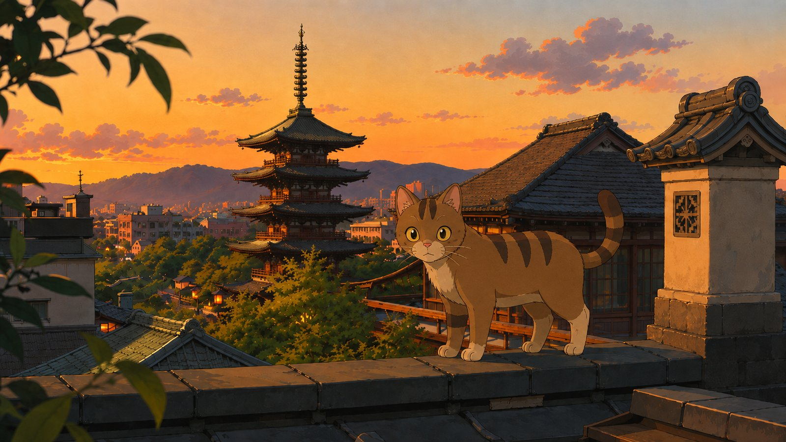
  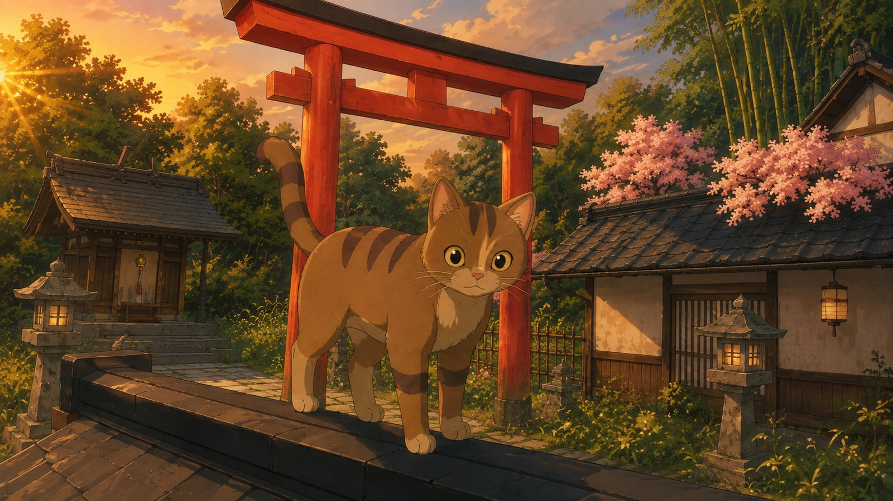
</p>
<p align="center">
  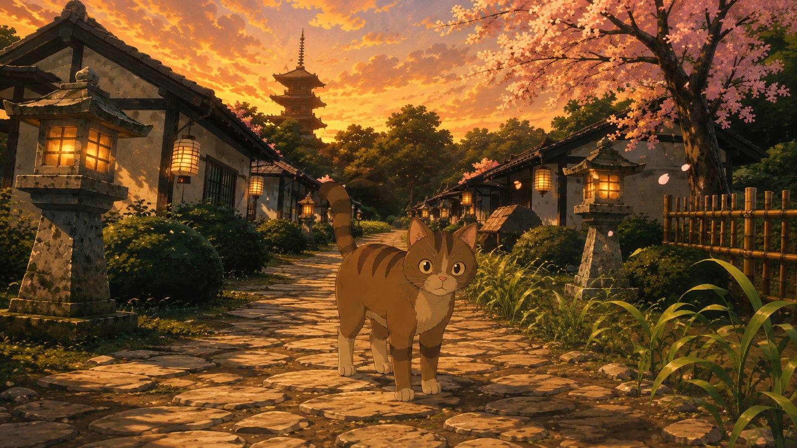
  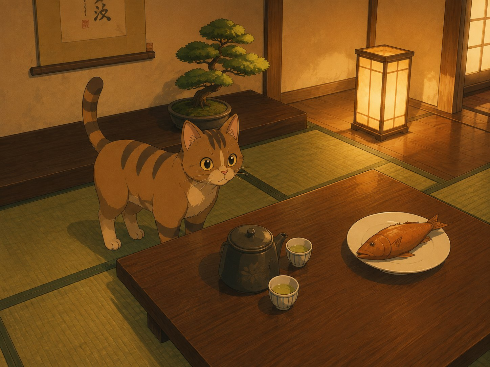
</p>
<p align="center"><sub>Concept art: a rooftop at sunset · Michi at the torii · the village path at dusk · the tea-ceremony room. The title screen's backdrop, <code>title-screen.jpg</code>, is concept art too.</sub></p>

The teaser video (v3, 2026-09-29) is an edit of early game footage, from before the cat was rebuilt, ending on concept art:

<div align="center">

<video src="https://github.com/user-attachments/assets/98beca05-d17b-4123-a8c6-fa52245a155d" poster="https://raw.githubusercontent.com/c1t1zen1/Michi-Neko-The-Cat-Philosophers-Path/main/docs/images/hero-torii-dusk.jpg" controls muted playsinline width="100%">
  <a href="https://github.com/user-attachments/assets/98beca05-d17b-4123-a8c6-fa52245a155d">▶ Watch the teaser video</a>
</video>

</div>

---

## License

MIT License — see [LICENSE](LICENSE) for details.

---

## Credits

- **Concept & Design:** Inspired by a honeymoon trip to Kyoto and a lifetime of Studio Ghibli films
- **Code:** Vibe coded with multiple SOTA AI models
- **Engine:** Three.js by Ricardo Cabello (Mr.doob) and contributors
- **Cat avatar:** Procedurally sculpted, skinned mesh with Ghibli-style toon shading
- **Companion tools:** dawCAT and cadJS, built with the same vibe-coding workflow

---

**🐾 Made it to the end? Go say hello to Michi-Neko:**

[](https://c1t1zen1.github.io/Michi-Neko-The-Cat-Philosophers-Path/)

*猫の散歩 — A cat's stroll through Kyoto. Take your time. There's nowhere you need to be.*
