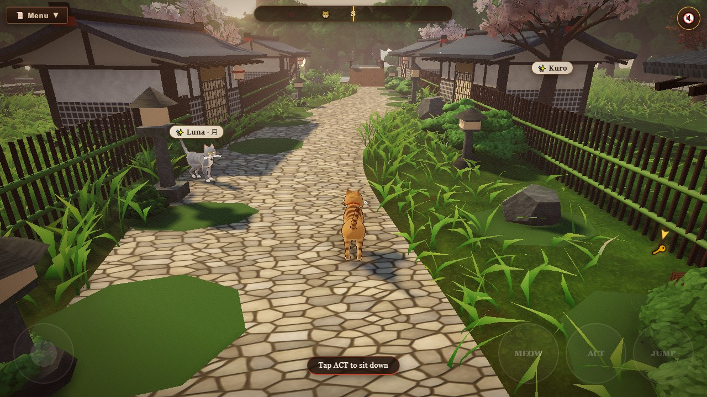
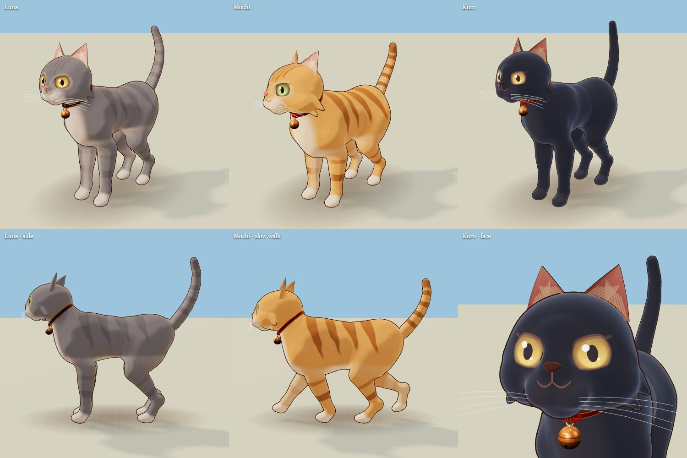
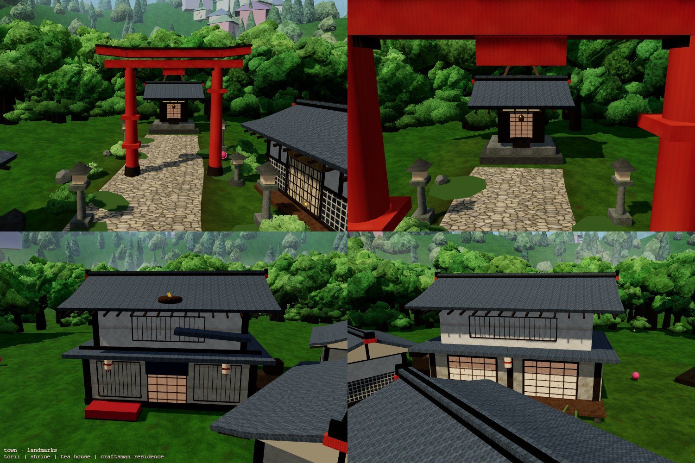
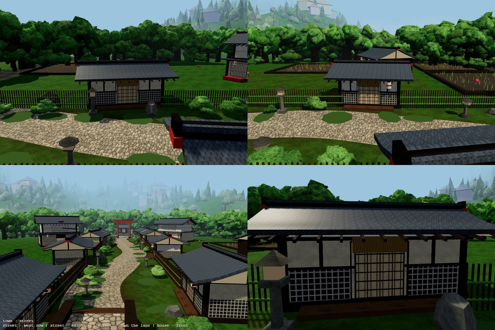
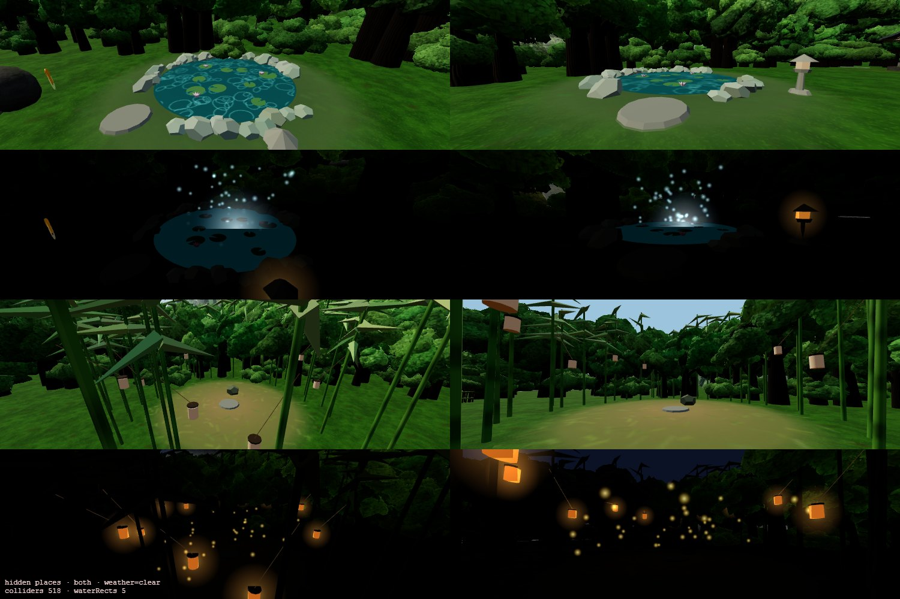
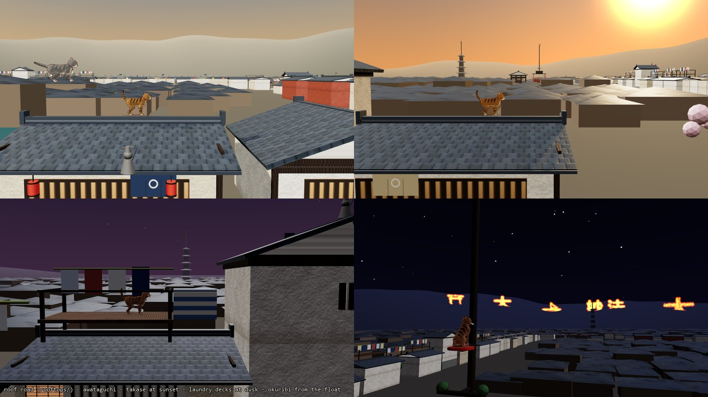
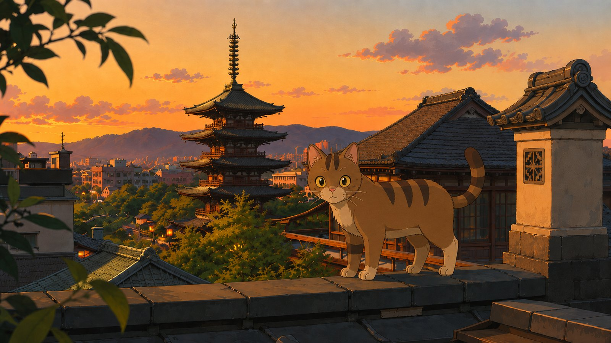
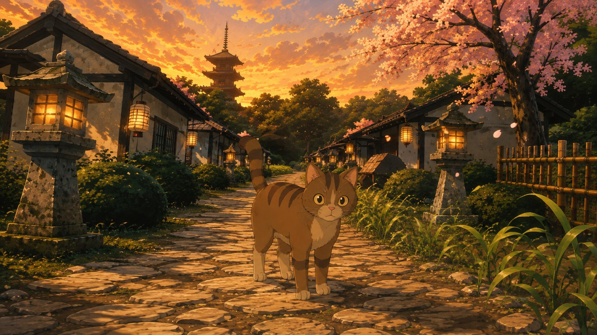
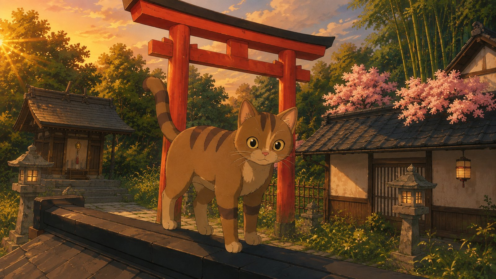
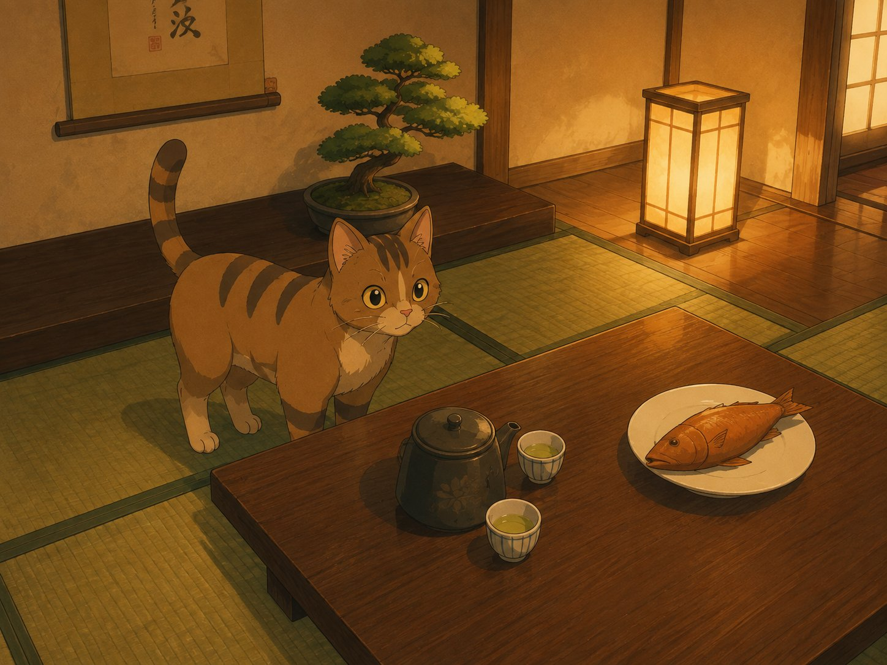

# 🐾 Michi-Neko The Cat Philosopher's Path — 道猫
[](https://c1t1zen1.github.io/Michi-Neko-The-Cat-Philosophers-Path/) [](https://threejs.org/) [](https://www.khronos.org/webgl/) [](LICENSE) [](https://github.com/c1t1zen1/Michi-Neko-The-Cat-Philosophers-Path)  [](https://github.com/c1t1zen1/Michi-Neko-The-Cat-Philosophers-Path/stargazers)
<div align="center">

<video src="https://github.com/user-attachments/assets/98beca05-d17b-4123-a8c6-fa52245a155d" poster="https://raw.githubusercontent.com/c1t1zen1/Michi-Neko-The-Cat-Philosophers-Path/main/docs/images/title-screen.jpg" controls muted playsinline width="100%">
  <a href="https://github.com/user-attachments/assets/98beca05-d17b-4123-a8c6-fa52245a155d">▶ Watch the teaser video</a>
</video>

</div>

### A Third-Person Cat Exploration Game set in a Kyoto-Inspired Valley

**🐾 Ready to explore Kyoto? Play now — free, instant, no install:**

[](https://c1t1zen1.github.io/Michi-Neko-The-Cat-Philosophers-Path/)

*Free · No download · No install · Just click and stroll.*

**🌿 New — the Grass Lab:** twenty procedural Three.js grasses, each in a live isometric cube, plus a floating patch where Michi walks through them and bends the blades.

[](https://c1t1zen1.github.io/Michi-Neko-The-Cat-Philosophers-Path/grass/)

*Opens on GitHub Pages · [how it was made &amp; research notes](docs/GRASS_RESEARCH_2026-10-23.md) · [source in `grass/`](grass/)*

**⛩ New — the Roof Road (prototype):** a side-scrolling run over the roofs of old Kyoto, past the valley bridge. It goes through seven real places, from the Sanjō bridge gate to the top of a Gion Matsuri float, and ends with the five Okuribi fires lighting the hills.

[](https://c1t1zen1.github.io/Michi-Neko-The-Cat-Philosophers-Path/rooftops/)

*Opens on GitHub Pages · [design](docs/superpowers/specs/2026-10-24-rooftop-road-design.md) · [inner-Kyoto research](docs/ROOFTOPS_RESEARCH_2026-10-24.md) · [source in `rooftops/`](rooftops/)*

> **Status:** Very Early Alpha · Built with vibe coding and several SOTA AI models  
> **Inspiration:** Studio Ghibli films and a honeymoon trip to Kyoto, Japan  
> **Engine:** Three.js (r160) · WebGL 2.0 · Pure browser — no dependencies to install  
> **License:** MIT
> **Last updated:** 2026-10-24 · cache tag `20261024a` · see [Recent Updates](#-recent-updates)

---

## 🎨 Art & Design Vision

> **✏️ Note on the images in this README:** Michi-Neko is in **very early alpha**. The artwork sprinkled through the sections below is mostly **inspiration art** — it shows the scenery, mood, and style the game's design plans to grow into. The captures in the next section are the exception: the first is a real in-game frame, the rest are rendered by the game's own builders (the same `Cat`, `Countryside` and `HiddenPlaces` code that runs in the browser), without the in-game post-processing.

### From the build

<p align="center">
  
</p>
<p align="center">
  
</p>
<p align="center">
  
</p>
<p align="center">
  
</p>
<p align="center">
  
</p>
<p align="center">
  
</p>

---

## 🆕 Recent Updates

A running log of what has landed since the first public alpha. Status key: ✅ shipped · 🟡 shipped, still being tuned · 🔲 not started.

| Date | Update | Status |
|------|--------|--------|
| 2026-10-24 | **[The Roof Road](https://c1t1zen1.github.io/Michi-Neko-The-Cat-Philosophers-Path/rooftops/)** (prototype): research into inner Kyoto and a playable greybox of a new area past the bridge. A 2.5D run over machiya roofs through seven "mouths" of the old city (Awataguchi, Pontochō, the Takase canal, the Nishiki canopy, laundry decks, the Gion Matsuri float streets, the Okuribi fires), with turns where the street grid turns. It uses the real cat, a guide cat called Chidori, seven Shōki roof guardians to greet, and the game's own jump physics. A test runs the whole route on autopilot and checks that there are no soft-locks. Not yet in the valley: the unlock (walk the bridge railing post to post until the bamboo on the old earthen wall parts) is designed for the next pass | 🟡 |
| 2026-10-24 | **The Grass Lab grows in the game** — the old patchy meadow is gone. The valley and the summit clearing now grow every Lab recipe, each in the places it suits: Bezier tufts that keep the cat's trail near the camera, tri-quad clumps and painted cards further out, a shell carpet under the paws, cat-eye thicket along paths and walls, wildflower drifts, susuki on the river banks and the wild rim, mown lawns in the shrine precinct, moss pillows at tree roots and the Moon Pool, lantern fibres that glow at night in the Lantern Glade, yarn curls in the turtle corral, sumi-e brush grass by the summit's ensō stone, and fireflies over the river after dark. A biome mask painted from the real buildings, paths and water decides what grows where. Villagers part the grass too. What to rebuild next: [docs/VISUAL_NEXT_STEPS_2026-10-24.md](docs/VISUAL_NEXT_STEPS_2026-10-24.md) | 🟡 |
| 2026-10-23 | **[Grass Lab](https://c1t1zen1.github.io/Michi-Neko-The-Cat-Philosophers-Path/grass/)** — twenty procedural grass designs (five re-grown from the game's meadow, five from the research, five cross-breeds, five experiments) in live isometric cubes with measured CPU stats, plus a hero slab where the real cat walks through them with GPU spring-and-trail grass physics | ✅ |
| 2026-10-23 | **Comfort & accessibility settings** — field of view, interface size, larger dialogue text, high-contrast prompts, *Reduce Motion* (follows your OS setting), film-grain and lens-fringe toggles | ✅ |
| 2026-10-23 | **Villager personalities** — Luna is now silver smoke-grey, Mochi ginger, Kuro solid black; each cat has its own size, idle habits and greeting; Mochi curls up to sleep at night | ✅ |
| 2026-10-23 | **Hidden valley places** — the *Moon Pool* and the *Lantern Glade*, each with its own light, sound, journal entry and stillness moment | ✅ |
| 2026-10-23 | **Light & water** — lanterns kindle one after another at dusk, low river mist at dawn, raindrop rings on the river and ponds | ✅ |
| 2026-10-23 | **Town quality pass** — namako-kabe skirt walls, eave beams and wall studs on the village machiya; lacquered torii with swept *kasagi* and black base collars | ✅ |
| 2026-10-23 | **Review tools** — `town_preview` and `hidden_preview` sheets; real build captures in this README | ✅ |
| 2026-10-22 | **Cat rebuild** — sculpted-and-skinned body, leg-IK gait, painted face, braided collar and bell, per-villager builds ([glow-up video](docs/social/cat-anatomy-glow-up/README.md)) | ✅ |
| 2026-10-22 | **cadJS Procedural Studio** — 15 Kyoto prefabs, 16 painterly textures, 10 material palettes and 8 cat poses, driven from the menu or the AI agent | ✅ |
| 2026-10-22 | **dawCAT Wave Lab** — Audacity-style sample manipulator, recorder and chromatic-sampler builder, plus a 42-groove drum rhythm library | ✅ |
| 2026-10-21 | **dawCAT 2.0** — procedural *Sound Design* studio (24 templates, zero-file `sfx-pack.js`) and a streaming, self-repairing AI assistant | ✅ |
| 2026-10-05 | **Summit Clearing (天上)** — a secret wind-combed meadow above Kyoto, reached by ringing the shrine bell ten times; Kyoto vista polished 2026-10-22 | 🟡 |
| 2026-09-29 | cadJS single-item workspace, teaser video v3, tea-house bonsai | ✅ |
| 2026-09-26 | **cadJS ↔ game round trip** — import catalog symbols, "Push to game" publishes `cad-overrides.json`, applied at load by `src/cad_overrides.js` | ✅ |
| 2026-09-12 | Walkable bamboo grove; quest-giver cats always talk until the quest is claimed | ✅ |
| 2026-09-11 | **Build-guide phases** — versioned saves with backup, rest-and-watch spots, stillness moments, discovery journal, cat verbs, Offering Bell quest, weather-reactive dialogue | ✅ |
| 2026-09-10 | **Performance pass** — two-stage adaptive resolution, tiered quality, spatially chunked instancing, collider grid, context-loss recovery | ✅ |
| — | Real-device performance benchmarks (phones, iGPUs) | 🔲 |
| — | Input remapping, gamepad, left-handed touch layout | 🔲 |

---

## ✨ About

**Michi-Neko** is a meditative third-person exploration game where you play as a small tabby cat wandering a stylized Kyoto valley. There are no enemies, no timers, and no fail states. You explore a hand-crafted countryside dotted with machiya townhouses, a vermilion torii shrine, a flowing river with koi, bamboo groves, and a hidden tea house waiting to be discovered.

The game was created as an experimental art piece — built primarily through **vibe coding** with several state-of-the-art AI language models. It is very early alpha: the core loop works, the world is beautiful, but much remains to be built. We're sharing it early because we think the vibe is already worth experiencing.

<p align="center">
  <a href="https://c1t1zen1.github.io/Michi-Neko-The-Cat-Philosophers-Path/"></a>
</p>

### Inspirations

- **Studio Ghibli** — the warm, hand-painted aesthetic of films like *The Cat Returns* and *Spirited Away*
- **Kyoto, Japan** — a real honeymoon trip that sparked the vision: machiya streets, torii gates, temple bells, koi ponds, bamboo forests
- **Journey, Outer Wilds, A Short Hike** — exploration-first games that reward curiosity over combat

---

## 🎮 Features (Alpha)

### World & Atmosphere
- **Procedural Kyoto valley** — machiya townhouses, torii shrine gate, stone paths, river with water physics, bamboo groves, cherry trees, and surrounding mountains
- **Dynamic day/night cycle** — a full 24-hour loop compressed to 60 minutes, with sunrise, golden hour, sunset, and night each bringing unique lighting moods
- **Living weather system** — clear, cloudy, rain, snow, and mist states that transition smoothly and affect fog, lighting, and audio
- **Procedural PBR materials** — every surface is painted at load time: lime plaster with sill grime, grained timber, staggered kawara roof tiles, glowing shoji lattice, woven tatami, river-stone cobbles and fissured bark, each with a matching normal map, so walls and roofs catch light with real relief
- **Curved Kyoto rooflines** — roof slopes carry the concave *sori* lift toward the eaves, with rows of round end-tiles and rafter tails under every eave
- **Painterly foliage shader** — one shared shader for sakura, maples, pines, street bushes and the forest wall: lumpy noise-displaced canopies with leaf-clump relief, top-lit crowns, cool violet undersides, sun translucency and wind sway; bushes rustle when the cat brushes through
- **Shadow-receiving meadow** — 70k instanced grass blades that darken under trees and eaves, bend under the cat's paws and glow when the low sun shines through them; petalled wildflowers grow in drifts
- **Ridged mountain walls** — a noise-driven height field carries the valley floor into wooded foothills and blue-hazed peaks instead of cone silhouettes
- **Living river** — a fresnel water shader with sun-tracking specular, drifting sparkle, lapping bank foam and molten dusk tones
- **Cinematic post stack** — depth-based ambient occlusion, exponential height fog with sun in-scatter, screen-space crepuscular light shafts, bloom, ACES tone mapping and a filmic grade (split-toning, vignette, grain)
- **Image-based lighting** — the sky dome is re-baked into a prefiltered environment map as the day cycles, so tiles, lacquer, water and bronze reflect the real sky and sun
- **Night lanterns that light the street** — a pool of point lights hops between the lanterns nearest the cat, flickering warm pools onto the cobbles after dusk; each lantern kindles at its own moment as the light fails, and village windows glow behind them
- **Dawn river mist** — low, drifting mist hugs the water around 06:15 and burns off by mid-morning (thicker in misty weather)
- **Rain on water** — a dedicated pool of raindrop rings dimples the river and ponds during rain, separate from the cat's and koi's ripples
- **Edo skirt walls** — village machiya wear *namako-kabe* (dark slate tiles in raised white joints), eave beams and wall studs; the torii has brushed-lacquer grain, a swept *kasagi* and black base collars
- **Hidden valley places** — the **Moon Pool** (a still spring west of the shrine grove: turquoise caustics by day, moon-glow and rising motes by night, glassy pentatonic drops) and the **Lantern Glade** (a bamboo ring with paper lanterns that kindle in turn, fireflies, hollow bamboo knocks and breaths of leaves). No markers point to them — wander, or follow the scent trail when you get close

<p align="center">
  
</p>

### The Cat
- **Sculpted, skinned cat** — one seamless coat sculpted from soft anatomical forms (deep ribcage tucking into the waist, sliding shoulder blades, haunches) and skinned to a feline skeleton: forelegs with a backward elbow, hind legs in the thigh → stifle → hock zig-zag, rounded paws, a six-bone tail about half the body's length, and a round head with cheek fluff and a short muzzle. Luna, Mochi and Kuro each get their own build (slender, round, long-limbed)
- **Painted Ghibli face** — big amber eyes with heavy ink lids, catchlights, mood-sized pupils, real blinks (and slow "I trust you" blinks), the "ω" mouth that opens to meow and yawn, a pink (or dusky, on black cats) nose, white whiskers, tufted ears; NPCs turn their heads to follow you
- **Procedural tabby coat** — exactly four bold mackerel stripes across the back, forehead "M", cheek lines, leg bars, tail rings with a dark tip, cream bib, belly and socks, painted in bind-pose space so it rides the animation; three-band toon ramp, painterly grain, a true silhouette rim light keyed to the sun, and a cool sheen that keeps black cats black
- **Braided silk collar** — a kumihimo cord with gold edge threads and a little bow, carrying an engraved suzu bell (equator band, sound slit, sakura crest); Master Cat rank turns it gold and adds a twin
- **Cat animations** — paws are placed by leg IK, so they plant without sliding: a lateral-sequence walk that eases into a trot and, when sprinting, a rotary gallop with spine flexion; jump, land, prowl crouch (shoulder blades up, tail low), turn-in-place steps, and the head held level through it all. Idle verbs are real cat poses: sit with the tail wrapped round, lick-a-paw grooming, play-bow stretch, yawn, crouch-to-drink, and a curled-up sleep. Plus ear flicks, tail sway, a bottlebrush tail when startled, and mood expressions (curious, playful, cautious, alert, sleepy)
- **Villager personalities** — Luna (silver smoke-grey, slender) grooms and sits, and greets with a slow blink; Mochi (ginger, round) stretches, yawns and bounds up playfully, and curls up to sleep at night; Kuro (solid black, long-limbed) sits and watches, wary at first, warming as you linger. Each reacts to being noticed, greeted, or startled by a sprinting cat
- **Prowl mode** — crouch low and move quietly at reduced speed (press C)
- **Scent trail** — warm particle wisps drift up behind the cat as it moves, fading from gold to amber

### Gameplay
- **Yarn ball collectibles** — scattered throughout the valley, each gives XP and triggers a satisfying chime
- **Quest system** — Luna's Yarn Hunt introduces the world and rewards exploration
- **Progression ranks** — Kitten → Curious Cat → Backyard Explorer → Rooftop Wanderer → City Legend, each unlocking sprint, jump boost, and speed upgrades
- **Three NPC cats** — Luna (mysterious moonlight cat), Mochi (cheerful bamboo grove cat), and Kuro (quiet river guardian) — each with their own coat, build, dialogue and daily routine: Luna keeps watch from the old bridge at night, Kuro visits the river in mist and shelters under the tea-house eave in rain, Mochi chases bamboo leaves in the wind and sleeps at night
- **Quests and secrets** — Luna's Yarn Hunt (and Luna's Leap, which leads to the turtle corral and the Jade Paw), Kuro's Offering Bell quest, the spirit altar that only appears in mist, the golden feather on the rooftop nest — see [NPC_TASKS_AND_ENDGAME_GUIDE.md](NPC_TASKS_AND_ENDGAME_GUIDE.md)
- **Rest & watch spots** — sit and watch at the shrine steps, old bridge, rooftop perch, bamboo clearing, tea-house porch, the two hidden places (and the torii crown, once you are a City Legend). Stay still for about eight seconds and a *stillness moment* arrives, written for the time of day and the weather
- **Discovery journal (press J)** — a keepsake memory of the valley, not a checklist: places found, quiet moments, photographs stamped at rest spots, weather memories, keepsakes
- **Cat verbs and micro-interactions** — sit / groom / stretch, slow-blink at an NPC, gift a yarn ball, bat the furin chime, tip the shishi-odoshi, scratch the bamboo and fence post
- **Secret summit clearing (天上)** — ring the shrine bell ten times and step into the light to reach a wind-combed meadow above Kyoto with the city, Osaka and the bay descending through layered distance. No quests, no hints, no NPCs: sit still and the cat sleeps. *(Under active development; has its own sound-bath music mood, monk-choir and singing-bowl audio, and an optional transition video.)*
- **Secret tea house** — find the antique key hidden near the bamboo shrine, unlock the machiya door, and step inside a fully modeled Japanese interior with tatami mats, tokonoma alcove, hanging scroll, bonsai, and a zen rock garden
- **Interior interactions** — eat grilled sea bream for a speed boost, curl up on a zabuton cushion for a cozy nap that advances time by 4 hours
- **Rooftop bird's nest** — climb to the highest point to discover a nest with a guardian's feather trophy
- **Shrine bell** — ring the sacred bronze bell at the torii gate for blessings
- **Koi pond** — wade into the river to paw at swimming koi fish or drink fresh water
- **Photo mode** — press P to enter a free-camera photo mode, orbit/zoom, and capture PNG screenshots

<p align="center">
  
</p>

### Audio
- **Generative day-phase music** — a real-time music director that layers a warm pad drone with sparse koto-style plucks, shifting key and mood across dawn, day, dusk, and night
- **Procedural sound effects** — footsteps (grass/water), meow, jump, land, collect chime, bell, splash, purr, door slide, key chime, dream chime, eat, lap water, trill — all synthesized via Web Audio API, no audio files needed
- **Adaptive ambient** — weather-aware ambient layers that crossfade between clear, rain, and mist soundscapes
- **Place-specific sound** — the Moon Pool's glassy drops and the Lantern Glade's bamboo knocks and leaf breaths are synthesised live and fade with distance; the Tea House and the summit each get their own music mood
- **Replaceable by design** — [dawCAT](#-companion-tools) can scan the game's music and sound effects and export drop-in replacements (`music.js`, `sfx-pack.js`) without touching game code

### UI & UX
- **Japanese parchment scroll HUD** — an emakimono-style collapsible scroll showing yarn count, rank, XP bar, active quest, time/weather, and inventory badges
- **Compass strip** — top-center compass with cardinal directions and POI icons for NPCs, the tea house, and collectibles
- **Objective markers** — screen-space waypoint icons with distance labels and an off-screen edge arrow
- **Title screen** — animated paw logo, cinematic orbit camera, and New Game / Continue / Settings menu
- **Settings panel** — master/music/SFX/ambient volume sliders, camera sensitivity, invert Y, graphics quality (auto/low/medium/high), hint toggle, interface mode (*Minimal* keeps only the context prompt; *Guided* adds the parchment and markers), and save export/import — all persisted to localStorage
- **Comfort & accessibility** — field of view (40–90°), interface size (80–150%), larger dialogue text, high-contrast prompts and dialogue, *Reduce Motion* (follows your OS preference unless you override it: stills FOV kicks, camera auto-follow swing, the title orbit, rest-camera drift, film grain, lens fringe and CSS animation), grain and fringe toggles
- **Soft guidance** — waypoint arrows only guide when hints are on; the scent trail only flows near things worth finding
- **Touch controls** — virtual joystick, JUMP, ACT, and MEOW buttons for mobile play
- **Debug overlay** — press F3 for FPS, draw calls, triangle count, and GPU memory info

### Technical
- **Adaptive resolution** — two-stage governor: stage 1 sheds light shafts and quarters the bloom, stage 2 scales the framebuffer; recovers with hysteresis. An eco frame floor (30 fps) protects long sessions from heat, and touch devices run the title screen at half rate
- **Graphics quality tiers** — Low: 1024 shadow map, height fog only; Medium: 2048 shadows, half-resolution ambient occlusion (8 samples), light shafts, bloom; High: 4096 shadows, 14-sample AO, full light shafts, chromatic fringe. MSAA (4x) is kept through the post chain via a multisampled HDR target with a resolved depth attachment
- **Camera collision** — soft raycast camera collision prevents clipping through walls
- **Platformer physics** — coyote time, jump buffering, and variable jump height for responsive platforming
- **Save/load** — auto-saves every 12 seconds and on page-hide to localStorage (position, score, XP, quest state, collected items, world state, journal, time of day, weather). Versioned schema with migration, a rotating backup copy, validation on read, and JSON export/import
- **WebGL context-loss recovery** — a calm "the valley is resting" screen, an immediate save, and automatic restore (or reload-and-continue)
- **Spatial culling** — wide instanced vegetation sets are split into spatial chunks so frustum culling works, and a uniform grid answers collision and camera-ray queries instead of scanning every box
- **Startup calibration** — the title screen's frame rate is sampled once to pick a safe starting tier on weak devices
- **CAD overrides hook** — `cad-overrides.json` published by cadJS is applied by name at load; a missing file is ignored
- **Seeded procedural generation** — deterministic world layout using mulberry32 PRNG
- **Instanced particles** — rain, snow, cherry petals, fireflies, dust, and water ripples using pooled instanced meshes; each tier caps both the drawn *and* the simulated count
- **Verification** — 35-module syntax check, a headless summit state-machine suite, review sheets for the cat, trees, town and hidden places, and a 44-check browser smoke suite (see [docs/VERIFICATION_REPORT_2026-09-11.md](docs/VERIFICATION_REPORT_2026-09-11.md)); a full headless boot was re-verified clean on 2026-10-23

---

## 🚀 Quick Start

**Michi-Neko** is free to play in your browser — no install needed:

[](https://c1t1zen1.github.io/Michi-Neko-The-Cat-Philosophers-Path/)

Prefer to run it locally? You just need a local web server (ES modules require it).

```bash
# Python 3 (built-in on most systems)
py -m http.server 8080 --bind 127.0.0.1

# Or with Node.js
npx serve -l 8080
```

Then open **http://127.0.0.1:8080** in your browser.

> 📖 See **[INSTALL.md](INSTALL.md)** for detailed setup instructions and **[QUICKSTART.md](QUICKSTART.md)** for the extended gameplay guide.

### 📚 Documentation

| Document | What's in it |
|----------|--------------|
| [INSTALL.md](INSTALL.md) | Running the game locally, browser/device setup, troubleshooting |
| [QUICKSTART.md](QUICKSTART.md) | Extended gameplay manual — controls, progression, secrets |
| [NPC_TASKS_AND_ENDGAME_GUIDE.md](NPC_TASKS_AND_ENDGAME_GUIDE.md) | Every NPC task, dialogue riddle and end-game reward |
| [FUTURE_QUESTS.md](FUTURE_QUESTS.md) | Planned quests, world expansion and story direction |
| [AGENTS.md](AGENTS.md) | Contributor / agent notes: run, cache-busting, verification sheets, guardrails, status |
| [docs/NEXT_STEPS_CHECKLIST_2026-10-22.md](docs/NEXT_STEPS_CHECKLIST_2026-10-22.md) | The 2026-10-23 upgrade checklist, with what shipped and what is still open |
| [docs/NEXT_STEPS_FEEDBACK_2026-10-22_195413.md](docs/NEXT_STEPS_FEEDBACK_2026-10-22_195413.md) | The feedback that drove that checklist |
| [docs/BUILD_GUIDE_2026-09-11_041436.md](docs/BUILD_GUIDE_2026-09-11_041436.md) | Parallel-agent build checklist (workstreams A/S/P/AU/C/N/G/U/V) with live status |
| [docs/GAME_MASTER_REVIEW_2026-09-11.md](docs/GAME_MASTER_REVIEW_2026-09-11.md) | Merged master review the build guide came from |
| [docs/VERIFICATION_REPORT_2026-09-11.md](docs/VERIFICATION_REPORT_2026-09-11.md) | Measured results of the 44-check browser suites |
| [docs/PERFORMANCE_REVIEW_2026-09-10_022247.md](docs/PERFORMANCE_REVIEW_2026-09-10_022247.md) | Mobile-first performance audit & optimisation plan |
| [docs/SBA_REVIEW_20260927_031251.md](docs/SBA_REVIEW_20260927_031251.md) | Senior build assessment (mobile-first lens) |
| [docs/DAW_CADJS_DEEP_REVIEW_2026-09-20.md](docs/DAW_CADJS_DEEP_REVIEW_2026-09-20.md) | Feature-completeness review of dawCAT and cadJS |
| [docs/SOCIAL_POST_PLAN_2026-10-22_195413.md](docs/SOCIAL_POST_PLAN_2026-10-22_195413.md) | Build-in-public post plan; finished posts live in [docs/social/](docs/social/) |
| [docs/GRASS_RESEARCH_2026-10-23.md](docs/GRASS_RESEARCH_2026-10-23.md) | Grass Lab research: what 15 searches found, the numbers, the design decisions, sources |
| [docs/VISUAL_NEXT_STEPS_2026-10-24.md](docs/VISUAL_NEXT_STEPS_2026-10-24.md) | Ranked list of what to research and rebuild next, after the grass |
| [docs/ROOFTOPS_RESEARCH_2026-10-24.md](docs/ROOFTOPS_RESEARCH_2026-10-24.md) | Roof Road research: inner Kyoto's walls, gates, machiya roofs, districts and festivals, cat jump numbers, 2.5D path design, sources |
| [docs/superpowers/specs/2026-10-24-rooftop-road-design.md](docs/superpowers/specs/2026-10-24-rooftop-road-design.md) | Roof Road design: the unlock, the seven mouths, twists and turns, mechanics, how it goes into the game |
| [dawCAT/README.md](dawCAT/README.md) | dawCAT 2.0 audio studio manual |
| [cadJS/README.md](cadJS/README.md) · [cadJS/BUILD_GUIDE.md](cadJS/BUILD_GUIDE.md) | cadJS CAD workspace manual and build guide |
| [assets/README.md](assets/README.md) | Optional runtime media (summit vista model, transition video) |

> 🗄️ `OLD/archive-cat-city/` holds design docs and prototype code from the **predecessor
> project** (a first-person "Cat City FPS" concept). It is **not** this game — see
> [its README](OLD/archive-cat-city/README.md).

---

## 🎯 Controls

### Desktop

| Key | Action |
|-----|--------|
| `W` `A` `S` `D` / Arrows | Move |
| `Shift` | Sprint (unlocked at rank 2) |
| `Space` | Jump (hold for higher, tap for short hop) |
| `E` | Context action (talk, pick up, interact, enter/exit) |
| `M` | Meow |
| `C` | Toggle prowl mode |
| `P` | Photo mode (orbit camera, capture screenshots) |
| `J` | Discovery journal |
| `Esc` | Pause menu |
| `F3` | Debug overlay |
| Mouse drag | Rotate camera (yaw + pitch) |

### Mobile / Touch

| Touch | Action |
|-------|--------|
| Left joystick | Move (push to edge to sprint) |
| JUMP button | Jump |
| ACT button | Context action |
| MEOW button | Meow |
| Swipe right side | Rotate camera |

---

## 📁 Project Structure

```
Michi-Neko-The-Cat-Philosophers-Path/
├── index.html                  # Entry point — HTML, CSS, UI overlays
├── README.md                   # This file
├── INSTALL.md                  # Installation & setup guide
├── QUICKSTART.md               # Extended gameplay manual
├── src/
│   ├── main.js                 # Game class — orchestrates all systems
│   ├── player.js               # Player controller, camera follow, physics
│   ├── cat.js                  # Cat avatar: skeleton, gait, poses, moods
│   ├── cat_anatomy.js          # Cat proportions, builds, sculpt + part geometry
│   ├── cat_sdf.js              # Signed-distance sculpting, surface nets, skin weights
│   ├── cat_motion.js           # Pose blending and leg IK
│   ├── cat_shading.js          # Coat / face shader, outlines, collar & bell textures
│   ├── hidden_places.js        # Moon Pool + Lantern Glade (light, sound, discovery)
│   ├── mountaintop.js          # Secret summit clearing (天上) scene & transitions
│   ├── instanced_chunks.js     # Splits wide instanced meshes into culling chunks
│   ├── collider_grid.js        # Uniform grid for collision / camera-ray queries
│   ├── cad_overrides.js        # Applies cadJS "push to game" overrides at load
│   ├── controls.js             # Keyboard, mouse, touch input handling
│   ├── countryside.js          # Procedural Kyoto valley world generation
│   ├── textures.js             # Procedural PBR textures (plaster, timber, tiles, cobbles…) + normal maps
│   ├── foliage.js              # Shared painterly foliage shader & lumpy canopy geometry
│   ├── postfx.js               # Ambient occlusion, height fog / light shafts, film grade passes
│   ├── sky.js                  # Sky dome shader, day/night, weather, environment map
│   ├── vegetation.js           # Trees, bamboo, foliage; lays out the valley grass
│   ├── grass.js                # Game grass: Grass Lab recipes, biome mask, GPU spring/trail physics
│   ├── particles.js            # Rain, snow, petals, fireflies, dust
│   ├── ambient_life.js         # Birds, butterflies, koi fish, guardian crows
│   ├── interior.js             # Tea house interior scene & transitions
│   ├── context_actions.js      # Context-sensitive interaction system
│   ├── npc.js                  # NPC cats: personalities, routines, reactions, sleep
│   ├── dialogue.js             # Dialogue box system
│   ├── quest.js                # Quest tracking
│   ├── progression.js          # XP, ranks, skill unlocks
│   ├── audio.js                # Web Audio synthesis & spatial audio
│   ├── music.js                # Generative day-phase music director
│   ├── scent.js                # Scent trail particle system
│   ├── ui.js                   # HUD updates, toasts, debug overlay
│   ├── menus.js                # Title screen, pause menu, settings
│   ├── settings.js             # Settings persistence, comfort options, quality tiers
│   ├── save.js                 # Versioned save/load with backup, export/import
│   └── waypoints.js            # Screen-space objective markers & compass
├── tools/                      # Review sheets (cat, tree, town, hidden places, summit, grass) + verify scripts
├── assets/                     # Optional runtime media (summit vista GLB, transition video)
├── docs/                       # Reviews, build guide, checklists, social posts, artwork
├── data/                       # Development reference screenshots & Blender sources
├── dawCAT/                     # Companion audio studio — music, sound design, Wave Lab, AI assistant
├── cadJS/                      # Companion CAD workspace — Procedural Studio, push-to-game, AI agent
├── grass/                      # Grass Lab — 20 procedural grasses in isometric cubes + a cat-walk patch
├── rooftops/                   # The Roof Road — rooftop side-scroller prototype (lab, not yet in the game)
├── AGENTS.md                   # Contributor / agent notes
└── OLD/
    └── archive-cat-city/       # 🗄️ Archived predecessor project — see its README
```

---

## 🧰 Companion Tools

Two standalone browser apps, a grass test bench and a rooftop prototype live in the repo. None is needed to play, and none writes to the game's source.

### dawCAT 2.0 — audio asset studio (`dawCAT/`)
An Ableton-style DAW built from the game's own musical DNA. **Compose** (arrangement, piano roll, drum grid, mixer, devices, automation), **✦ Sound Design** (layered procedural SFX from 24 templates modelled on the game's sounds, exported as a zero-file `sfx-pack.js`), **🌊 Wave Lab** (import, record or resample audio; time-stretch, pitch, reverse, loop, filter, bitcrush; turn a sample into a chromatic sampler), a 42-groove drum rhythm library, and an **✦ AI assistant** that works with local models (llama-server, LM Studio, Ollama) or hosted providers, streams, self-repairs, and keeps every change one Ctrl+Z away. Run it at `/dawCAT/` from the game root. See [dawCAT/README.md](dawCAT/README.md).

### cadJS — CAD workspace (`cadJS/`)
A non-destructive Three.js workspace for inspecting, creating, reshaping, texturing, importing and exporting assets. It loads the real cat, scans the repo, picks objects out of the live game scene and can *push to game* as `cad-overrides.json`. The **Procedural Studio** adds 15 Kyoto prefabs (torii, pagoda, ishi-doro, bridge, hokora shrine, bamboo, sakura, bonsai, tsukubai, rock garden, neko statue and more), 16 painterly textures, 10 material palettes and 8 cat poses, all reachable from the AI design agent. See [cadJS/README.md](cadJS/README.md).

### Grass Lab — grass test bench (`grass/`)
**[Open it in your browser →](https://c1t1zen1.github.io/Michi-Neko-The-Cat-Philosophers-Path/grass/)** Twenty procedural Three.js grasses, each in its own live isometric cube with a how-it's-made note, code excerpt and measured CPU numbers. Blades are placed by a GPU hash (no per-blade buffers), bent by wind, and pushed by a small GPU spring simulation; at the bottom of the page the real `src/cat.js` cat walks a floating slab (walk, wander, tour, figure-eight, prowl, isometric or cat-eye view) on any one grass or on checkerboard, stripe, ring, random and all-twenty layouts. Locally, serve the repo root and open `/grass/` (or double-click `grass/serve.cmd` on Windows). Research and decisions: [docs/GRASS_RESEARCH_2026-10-23.md](docs/GRASS_RESEARCH_2026-10-23.md).

### The Roof Road — rooftop run prototype (`rooftops/`)
**[Run it in your browser →](https://c1t1zen1.github.io/Michi-Neko-The-Cat-Philosophers-Path/rooftops/)** A playable greybox of the next area: past the valley bridge, over the roofs of old Kyoto, side-on. Seven mouths, each a real place: the bridge gate at Awataguchi, Pontochō's two rows of roofs and its yuka decks, a takasebune drifting down the Takase canal, the long Nishiki canopy, laundry decks with futons to bounce on, and the Gion Matsuri float streets, where the run turns vertical up a hoko. On top, the five Okuribi fires light the hills one by one. The real `src/cat.js` runs it beside a guide cat, Chidori. The jump is the game's own, there is no fail state (the street is always underneath), and `node tools/rooftop_test.mjs` proves every platform can reach the finale. Arrow keys / A D to run, Space to jump, Shift to sprint, ↓ to drop; `?auto=1` lets it play itself. Locally, serve the repo root and open `/rooftops/` (or double-click `rooftops/serve.cmd` on Windows). [Design](docs/superpowers/specs/2026-10-24-rooftop-road-design.md) · [research](docs/ROOFTOPS_RESEARCH_2026-10-24.md).

### Review sheets (`tools/`)
Seeded, repeatable renders built through the real game classes: `cat_preview.html` (anatomy, face, coat, gait, poses, sleep, npcs), `tree_preview.html`, `town_preview.html` (street, landmarks, props), `hidden_preview.html`, `summit_preview.html`, `grass_preview.html` (valley grass at chosen spots, `?spots=shrine,river,corral,glade@21.5` for a 2×2 sheet). Run `node tools/verify.mjs` for the syntax, wiring and summit suites.

---

## 🛠️ Technology Stack

- **Three.js r160** — WebGL rendering, scene graph, post-processing
- **Web Audio API** — all sound and music is procedurally synthesized at runtime
- **ES Modules** — no bundler required; runs directly from a static server
- **Vanilla JavaScript** — no frameworks, no build step, no dependencies
- **localStorage** — save/load and settings persistence

---

## 🗺️ Roadmap

| Feature | Status |
|---------|--------|
| Core world & cat avatar | ✅ Done |
| Day/night & weather (incl. dawn mist, rain on water) | ✅ Done |
| NPCs, dialogue, quests | ✅ Done |
| Villager personalities, routines & reactions | ✅ Done |
| Interior (tea house) | ✅ Done |
| Progression & save/load (versioned, backup, export/import) | ✅ Done |
| Photo mode | ✅ Done |
| Generative music | ✅ Done |
| Cat anatomy rebuild, IK gait & idle poses | ✅ Done |
| Rest & watch spots, stillness moments, discovery journal | ✅ Done |
| Hidden valley places (Moon Pool, Lantern Glade) | ✅ Done |
| Comfort settings (FOV, UI size, text, contrast, reduce motion) | ✅ Done |
| Town quality pass (village machiya, torii) | 🟡 In progress — tea house & residence skirt walls, fences and lanterns next |
| Summit clearing (天上) | 🟡 In progress |
| dawCAT 2.0 & cadJS Procedural Studio | ✅ Done |
| Mobile performance levers (tiers, adaptive stages, chunking) | ✅ Done |
| Real-device performance benchmarks | 🔲 Planned — needs a device matrix |
| Input remapping, gamepad, left-handed touch layout | 🔲 Planned |
| Additional zones (park, commercial, industrial) | 🔲 Planned — deepen Kyoto first |
| More NPCs & story arcs | 🔲 Planned |
| PWA manifest & offline caching | 🔲 Planned |

---

## 🧠 How This Was Made

Michi-Neko was built primarily through **vibe coding** — a collaborative process where human creative direction meets AI code generation. Several state-of-the-art large language models contributed to different parts of the codebase, guided by a human who provided the artistic vision, design decisions, and Kyoto inspiration.

The result is a game that no single developer could have produced this quickly — a testament to the new creative workflows emerging at the intersection of human taste and AI capability. It's rough, it's alpha, and it's made with love.

<p align="center">
  
</p>

---

## 📜 License

MIT License — see [LICENSE](LICENSE) for details.

---

## 🌸 Credits

- **Concept & Design:** Inspired by a honeymoon trip to Kyoto and a lifetime of Studio Ghibli films
- **Code:** Vibe coded with multiple SOTA AI models
- **Engine:** Three.js by Ricardo Cabello (Mr.doob) and contributors
- **Cat avatar:** Procedurally sculpted, skinned mesh with Ghibli-style toon shading
- **Companion tools:** dawCAT and cadJS, built with the same vibe-coding workflow

---

**🐾 Made it to the end? Go say hello to Michi-Neko:**

[](https://c1t1zen1.github.io/Michi-Neko-The-Cat-Philosophers-Path/)

*猫の散歩 — A cat's stroll through Kyoto. Take your time. There's nowhere you need to be.*
