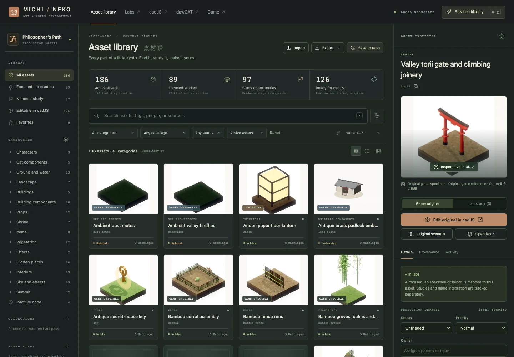

# Michi-Neko Asset Library

A production workspace for the game’s authored visual assets. Open
**[/catalog/](index.html)** from the served repository root, or
**[browse on GitHub Pages](https://c1t1zen1.github.io/Michi-Neko-The-Cat-Philosophers-Path/catalog/)**.

The library records **190 inventory entries: 186 active and four inactive**.
It brings together original game factories, named lab specimens, source
provenance, review imagery and editable production metadata. The
[coverage audit](../labs/ASSET_COVERAGE.md) defines the denominator and gaps.

[](index.html)

## Start

From the repository root:

```sh
node cadJS/server.mjs
```

Open **http://127.0.0.1:4173/catalog/**. The same server serves cadJS, the labs,
dawCAT and the game. No installation or build step is needed; use Node.js 22+
and a modern browser. The game and live 3D viewers load Three.js r160 from
the existing CDN import map.

For browsing on a plain static server:

```sh
python3 -m http.server 8000
```

Open http://localhost:8000/catalog/. Static hosting supports the catalog,
3D previews, production drafts, collections, JSON/CSV interchange and direct
provider requests. Repository saves and the AI relay require the local
cadJS server. Use the same origin for the catalog and cadJS when importing
companion settings; browser storage belongs to an origin.

## Browse, inspect and organize

- **Grid:** labeled original, study and context thumbnails. Type placeholders
  identify entries that have no suitable captured image.
- **List:** source-friendly names, IDs, categories, lab coverage, ownership
  and production status.
- **Production board:** drag cards between Untriaged, Research, In progress,
  In review and Approved. These are work statuses; approval does not change
  the audited lab coverage or claim a study has shipped.
- **Inspector:** compare the original and available updated study adapters,
  open the exact lab specimen, inspect source anchors and manage art notes.
- **Collections:** gather any asset IDs for an area or art pass. Add/remove
  members, rename or delete a collection; Undo retains the assets and notes.
- **Saved views:** retain a query and filters; edit or delete the view later.
- **Bulk work:** select checkboxes or Cmd/Ctrl-click assets to set status or
  add a collection. The current selection also supplies the assistant’s
  selected-asset context.

The interface follows production-browser patterns—thumbnail/list views,
metadata facets, collections, provenance and linked work status—documented
by [Epic’s Content Browser](https://dev.epicgames.com/documentation/unreal-engine/content-browser-in-unreal-engine),
[asset metadata filtering](https://dev.epicgames.com/documentation/en-us/unreal-engine/asset-metadata-in-unreal-engine)
and [Autodesk’s task/pipeline workflow](https://help.autodesk.com/cloudhelp/ENU/SG-Producer/files/pr-scheduling-tasks/SG_Producer_pr_scheduling_tasks_pr_tasks_pipeline_steps_html.html).
The implementation is sized for this repository: it is a local asset
workspace with Git-backed metadata, without an enterprise tracking service
or a team identity system.

### Search

Combine text and fields; quote phrases, prefix a token with `-` to exclude
it, and use `|` for alternatives within a field:

```text
group:Shrine -coverage:direct
"secret-house key"
cad:original owner:none
status:research|modeling tag:hero
source:interior
is:favorite
is:gap
```

Fields: `id`, `group` (aliases `category` / `type`), `coverage`, `status`,
`owner`, `tag`, `source`, `lifecycle`, `has`, `cad`, `is`, `priority`.
`has:lab` means a focused study; `has:notes`, `has:owner`, `has:tags` and
`has:cad` also work. Use the lifecycle dropdown to include inactive rows
before searching `lifecycle:inactive`.

`/` focuses search, Cmd/Ctrl K opens the assistant, arrow keys browse focused
cards, Enter selects the inspector, Escape closes a panel and Cmd/Ctrl Z
undoes a production change. Normal text-field undo is preserved.

## Originals, studies and cadJS

**124 original adapters** and **71 unique updated lab recipes** are explicitly
implemented in [asset-loader.mjs](js/asset-loader.mjs). They cover **126 active
inventory entries** with at least one available editing adapter. Counts
include contextual factories and an optional GLB; the returned `fidelity`
and caption describe those cases.

The 3D inspector and cadJS call the same allowlisted factory. They preserve
procedural material callbacks, shader defines and live uniforms. The viewer
offers orbit/zoom, camera presets, a turntable, animation pause, wireframe,
grid and PNG export. Some game physics and whole-scene effects need their
own lab or game context; an isolated model is not a replay of those systems.

**Edit in cadJS** opens:

```text
/cadJS/?asset=larry&variant=original
/cadJS/?asset=bamboo-fence&variant=lab&target=fences%2Fkoetsu
```

cadJS suppresses the asynchronous starter cat for an explicit handoff,
builds the requested object, selects/frames it, and registers a stable
`catalog.<asset-id>` baseline. Its workspace guard, geometry/material tools,
AI designer, package exports and Undo/Redo remain available. Handoff Undo
retains live objects so custom shader behavior survives. Imports are frozen
for editing; the separate viewer can animate them.

Catalog imports do not automatically overwrite game geometry or approve a
replacement. Use cadJS’s existing export and game-integration workflow to
review edits. Large effects and scene systems without an isolated adapter
have explicit limits and working source/review links.

**Original scene** opens existing game review sheets or the normal game,
with a note about scene-wide framing. It does not teleport the player or
modify saves. **Open lab** uses `?specimen=<selector>` to reveal and highlight
the actual named specimen; interiors also use room/craft selectors. Source
links include line numbers resolved from the current local anchor.

## Production metadata and saving

There are two separate records:

| Record | Purpose |
|---|---|
| `labs/asset_inventory.json` | Audited identity, game source, lifecycle and specimen evidence |
| `catalog/metadata.json` | Owners, status, priority, tags, notes, favorites, collections, views and activity |

Edits first become browser drafts. **Save to repo** writes the metadata file
through the local server with an atomic rename and revision comparison.
Concurrent repository changes return a conflict; the draft survives. The
next save offers an explicit draft-over-repository merge or a repository
reload. A merge preserves unrelated entries and uses draft records for
matching IDs. Export a workspace to keep a separate version before merging.
Commit the metadata file when the art-work update should enter Git history.

**Workspace JSON** transfers the editable overlay; import merges it with
Undo. **Visible assets CSV** exports the current result set, with quoted
cells and spreadsheet-formula prefix escaping. **Audited inventory JSON**
exports the read-only evidence record. Browser drafts are stored per origin;
exports or repository saves provide a portable copy.

## AI interface

Open **Ask the library**, then **Configure API**. The provider catalog and
request builder are shared with dawCAT, including llama-server, LM Studio,
Ollama, custom compatible gateways, OpenAI, Anthropic, OpenRouter, Gemini
and other providers already supported there. Base URL, model, reasoning
level and maximum output tokens are configurable. **Test connection** reads
the configured provider’s model list.

**Use dawCAT settings** or **Use cadJS settings** imports connection settings
already saved on the same origin. API keys use session storage by default;
device persistence requires the explicit checkbox. Keys never enter workspace
exports, metadata files or repository commits.

On the local server, requests use `/api/asset-library/ai` and `/probe`; the
relay forwards credentials only to the configured provider and does not log
or persist them. Static hosting can call a provider directly when it permits
browser CORS. Local HTTP model servers need a compatible page origin; an
HTTPS-hosted page may be blocked from contacting HTTP endpoints.

The model receives a compact catalog of all entries plus selected-source
details and saved notes. Plans can search, select, update metadata, create
collections and open original/lab/CAD destinations. Every plan is validated
against known IDs and allowed fields, displayed for review, then applied as
one undoable metadata transaction. Model output cannot execute JavaScript,
edit source coverage, delete game assets or write arbitrary files.

Examples:

```text
Find shrine assets without focused lab studies.
Find editable assets owned by nobody and propose a research collection.
Select the original key and explain where its study is.
Mark selected assets as research and high priority.
```

**Local catalog guide** works without a provider. It transparently interprets
catalog commands; it is not an LLM. Select a configured API for open-ended
reasoning. Local guide commands include the examples in the assistant,
`search: <structured query>`, selected status/priority/owner/note updates and
named collections. Invalid plans or failed requests leave the workspace
unchanged. Cancel stops the current request.

## Files and extension points

```text
catalog/
  index.html, styles.css, tokens.css, icon.svg
  preview.html, preview.css
  metadata.json                 production overlay
  thumbnails.json, thumbnails/ evidence-labeled WebP captures
  server.mjs                    optional repository persistence + AI relay
  js/
    model.mjs                   query, metadata validation, merges, CSV
    app.mjs                     browser workspace and interaction flow
    assistant.mjs               constrained plans and shared provider transport
    asset-loader.mjs            explicit original / lab object factories
    links.mjs                   specimen, review and source navigation
    preview.mjs, icons.mjs      isolated viewer and interface symbols
  tests/                        unit, API and optional browser suites
```

Add a new game type to the audited inventory before cataloging it. To enable
editing, add a specific original or study adapter; source text is never
evaluated as arbitrary code. Keep game imports in the cache-tagged
`labs/shared/game.js` bridge. Add a real specimen capture and its provenance
to the thumbnail manifest; [thumbnail notes](THUMBNAILS.md) document its
matching and refresh process. Unknown/uncaptured types retain explicit limits.

## Verification

From the repository root:

```sh
node tools/catalog_check.mjs
node tools/labs_coverage.mjs
node --test catalog/tests/*.test.mjs
node --test tools/labs_coverage_test.mjs
node tools/labs_check.mjs
cd cadJS && npm run check
```

Optional end-to-end suites use Playwright outside the application. Point
`PLAYWRIGHT_MODULE` at an existing Playwright package directory and, when
needed, `BROWSER_PATH` at its Chromium executable. With the local server
running:

```sh
node catalog/tests/browser-smoke.mjs
node catalog/tests/adapters-browser.mjs
node catalog/tests/cad-handoff-browser.mjs
```

`CATALOG_URL` defaults to `http://127.0.0.1:4173`. `CATALOG_QA_DIR` selects an
output directory; screenshots/results default to the system temporary
directory. Browser workflow tests use a fresh profile and mock the repository
save response. API tests use disposable directories. No QA art notes or keys
are written into the real metadata file. API protocol tests use a mock
provider; connecting to a live paid service requires the user’s credentials.
